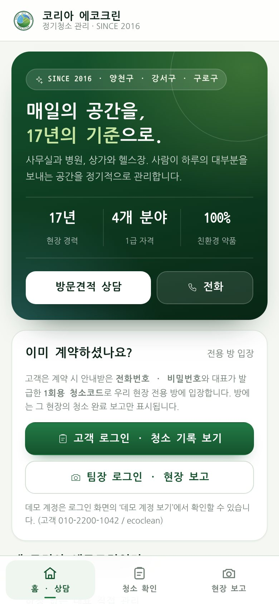

# 코리아 에코크린 — 현장 관리 PWA

사무실·병원·상가·헬스장 정기청소 전문 **코리아 에코크린**의 모바일 앱(PWA)입니다.
**빌드 도구 없이** HTML/CSS/JavaScript만으로 동작하고, **무료 호스팅**(GitHub Pages · Vercel · Cloudflare Pages)과
**무료 Supabase 플랜**에 그대로 올릴 수 있습니다. 서버 없이도 지금 바로 설치·테스트할 수 있도록
데이터는 기기 안(IndexedDB)에 저장됩니다.

- 브랜드: 코리아 에코크린 (대표 채종병)
- 전화 0507-1317-8369 · 이메일 koreaecoclean@naver.com
- 주소: 서울특별시 양천구 남부순환로36길 30, 1층 B01호 상가(신월동)
- 홈페이지: https://koreaecoclean.github.io/

---

## 1. 무엇이 들어 있나

| 탭 | 사용자 | 기능 |
| --- | --- | --- |
| **홈 · 상담** | 예비 고객 | 브랜드 소개, 4개 업종 정기청소 안내, 방문견적 상담 → **문자/전화 연결** |
| **청소 확인** | 고객 | 전화번호+비밀번호 로그인 → **1회용 청소코드** 인증 → **우리 현장 전용 방**에서 일자별 청소 보고 확인 |
| **현장 보고** | 팀장 | 전화번호+비밀번호+**팀장 고유코드** 로그인 → 담당 현장 선택 → **사진 3분류**·점검 항목·메모 → 등록 |
| **관리** | 대표(최고관리자) | 현장별 **1회용 청소코드 발급/상태 확인/복사**, **팀장 고유코드 발급·재발급**, 고객 방 입장 상태 확인 |

- 보고를 등록하면 **같은 기기의 고객 방에 즉시** 표시됩니다.
- 각 고객사는 **자기 현장 기록만** 볼 수 있습니다(방 격리).
- 사진은 기기 안에서 1600px · JPEG로 자동 압축(장당 약 150KB)되어 저장 공간을 아낍니다.
- PWA: 홈 화면 설치, 오프라인 실행, 하단 탭 내비게이션, iOS 안전 영역 대응.

### 화면 미리보기 (실제 실행 화면)

| 홈 · 상담 | 청소 확인 (고객 방) | 현장 보고 (팀장) | 관리 (대표) |
| --- | --- | --- | --- |
|  |  |  |  |

### 업로드 사진 3분류 (필수 요건)

팀장 보고 화면과 고객 보고 화면 모두 아래 3개 구역으로 나뉩니다.

1. **시건장치(잠금장치) 확인 사진** — 출입문 잠금·손잡이 상태 (필수)
2. **업장별 맞춤 청소 사진** — 사무실 / 병원·클리닉 / 상가·매장·식당 / 헬스장·사우나 유형에 맞춘 결과 (필수)
3. **새로 발생한 특이사항 사진** — 문제가 있을 때만, **특이사항 메모**와 함께 (선택)

---

## 2. 데모 계정 (그대로 테스트)

앱의 로그인 화면마다 **‘데모 계정 보기’**를 펼치면 같은 값이 나오고, **[입력]** 버튼으로 자동 채워집니다.

### 고객 (전화번호 + 비밀번호 → 1회용 청소코드)

| 고객사 | 담당 | 전화번호 | 비밀번호 | 1회용 청소코드 |
| --- | --- | --- | --- | --- |
| 행운타워 5층 사무실 (A고객사) | 정하윤 총무 | `010-2200-1042` | `ecoclean` | **`C-7F3K9Q`** |
| 하늘치과 신월점 | 김소연 실장 | `010-2200-2071` | `ecoclean` | **`C-2M8P4R`** |
| 바디캠프 피트니스 | 박준호 관장 | `010-2200-3310` | `ecoclean` | **`C-9T5W1B`** |

- 위 코드는 **미사용 상태**로 준비되어 있습니다. 한 번 입력하면 ‘사용 완료’가 됩니다.
- 이미 사용된 코드 예시: `C-3H8N6Z` (관리 화면에서 회색 처리 확인용)
- 코드를 이미 쓴 계정은 이후 로그인에서 코드 없이 바로 방에 들어갑니다.

### 팀장 (전화번호 + 비밀번호 + 팀장 고유코드)

| 이름 | 전화번호 | 비밀번호 | 팀장 고유코드 | 담당 현장 |
| --- | --- | --- | --- | --- |
| 김미영 팀장 | `010-3300-1042` | `team1234` | **`TL-4821`** | 행운타워 5층 사무실 |
| 이정숙 팀장 | `010-3300-2071` | `team1234` | **`TL-7365`** | 하늘치과 신월점 |

### 대표 · 최고관리자

| 이름 | 전화번호 | 비밀번호 | 비고 |
| --- | --- | --- | --- |
| 채종병 대표 | `010-9900-8369` | `ceo2016` | 로그인하면 하단에 **관리** 탭이 생깁니다 (팀장 코드 `TL-2016`로 현장 보고도 가능) |

> ⚠️ 위 값은 **데모 전용**입니다. 비밀번호는 기기 안에서만 비교되며 서버로 전송되지 않습니다.
> 실제 운영에서는 Supabase Auth로 교체하세요(9장).

### 5분 테스트 시나리오

1. **현장 보고** 탭 → 팀장 로그인(`010-3300-1042` / `team1234` / `TL-4821`)
2. 현장 선택 → **① 시건장치 사진**, **② 맞춤 청소 사진** 추가(카메라가 없으면 ‘샘플 사진 넣기’)
3. (선택) **③ 특이사항 사진** + 특이사항 메모 입력 → 점검 항목 체크 → **보고 등록하기**
4. 토스트의 **‘고객 화면’** → 팀장 미리보기로 3분류 사진이 그대로 보입니다
5. **청소 확인** 탭 → 고객 로그인(`010-2200-1042` / `ecoclean`) → **1회용 코드 `C-7F3K9Q`** 입력 → 방 입장
6. 방에서 방금 등록한 보고(날짜·시간·팀장·사진 3분류·점검 항목·특이사항)를 확인, 사진을 눌러 크게 보기
7. **관리** 탭(대표 로그인) → 코드 발급 → 새 코드가 목록에 추가되고, 사용한 코드는 ‘사용 완료’로 표시
8. 새로고침해도 모든 데이터가 유지됩니다.

---

## 3. 로컬에서 실행

ES 모듈 + 서비스 워커를 쓰기 때문에 **`index.html` 더블클릭으로는 동작하지 않습니다.**

```bash
# 이 폴더에서
python3 -m http.server 8000
# → http://localhost:8000
```

- VS Code **Live Server** 확장 → `index.html` 우클릭 → Open with Live Server
- Node가 있다면 `npx serve .`

`localhost`는 HTTPS 없이 서비스 워커가 동작합니다. 실제 배포는 **HTTPS 필수**입니다.
카메라 촬영은 HTTPS(또는 localhost)에서만 열립니다.

---

## 4. 폴더 구조

```
korea-ecoclean-app/
├─ index.html                  앱 셸 (헤더 · 4개 탭 · 라이트박스 · 토스트 · 다이얼로그)
├─ manifest.json               PWA 매니페스트 (이름 · 아이콘 · 바로가기)
├─ sw.js                       서비스 워커 (앱 셸 프리캐시, 오프라인 폴백)
├─ supabase-schema.sql         Supabase 무료 플랜용 테이블 · RLS · Storage 정책
├─ css/styles.css              디자인 토큰 + 전체 스타일
├─ js/
│  ├─ app.js                   부트스트랩 · 탭 라우팅(역할별) · 설치 배너 · SW 등록
│  ├─ auth.js                  고객/팀장/대표 로그인, 세션, 방 입장 권한
│  ├─ store.js                 데이터 계층 (Store 파사드 + IndexedDB/localStorage 어댑터)
│  ├─ seed.js                  현장 3곳 · 보고 10건 · 계정 6개 · 1회용 코드 4개
│  ├─ photos.js                사진 리사이즈/압축 · 샘플 사진 · 대체 이미지
│  ├─ ui.js                    공통 헬퍼 (esc · 날짜 · 토스트 · 라이트박스 · 확인창)
│  ├─ store-remote.example.js  Supabase 어댑터 예시 (앱에서 로드하지 않음)
│  └─ views/
│     ├─ home.js               홈 · 상담
│     ├─ customer.js           청소 확인 (고객 방)
│     ├─ leader.js             현장 보고 (팀장)
│     └─ admin.js              관리 (대표)
└─ assets/
   ├─ logo.png · favicon.svg · icon-192/512 · maskable · apple-touch-icon
   └─ samples/                 데모 사진 + thumbs/ (홈페이지 실제 현장 사진 + 생성 이미지)
```

모든 경로가 **상대 경로**라 `https://example.com/app/` 같은 하위 폴더 배포에서도 그대로 동작합니다.

---

## 5. 접근 제어 설계 (방 격리)

```
고객 ① 전화번호 + 비밀번호  →  계정 확인
     ② 1회용 청소코드        →  그 현장(room)에만 유효, 1회 사용 후 ‘사용 완료’
     ③ 방 입장 권한 부여     →  이후 같은 계정은 코드 없이 입장 (기기·계정 단위)
팀장 전화번호 + 비밀번호 + 팀장 고유코드  →  담당 현장만 표시
대표 전화번호 + 비밀번호                →  코드 발급·관리, 전체 현장
```

- 고객 방에는 **그 현장의 보고만** 조회됩니다(`siteId` 필터).
- 코드는 **현장별로 발급**되며, 다른 현장 코드를 입력하면 거부됩니다.
- 고객이 코드를 사용하면 관리 화면에서 **사용 완료(사용일·사용자)** 로 표시됩니다.
- 팀장이 코드를 재발급하면 **이전 코드는 즉시 무효**가 됩니다.
- 팀장은 담당 현장만 보고할 수 있고, 대표는 모든 현장을 볼 수 있습니다.
- 팀장·대표가 ‘고객 화면’을 열면 **미리보기**로 표시됩니다(고객에게 보이는 화면 확인용).

> 데모 인증은 브라우저에서 이뤄집니다. 실제 운영에서는 **반드시 서버 인증 + RLS**로 옮기세요.
> `supabase-schema.sql`에 역할별 정책 예시가 들어 있습니다.

---

## 6. 무료 배포

### 6-1. GitHub Pages (완전 무료)
```bash
# 이 폴더를 저장소 루트로 올리는 경우
git init
git add .
git commit -m "코리아 에코크린 PWA"
git branch -M main
git remote add origin https://github.com/<계정>/<저장소>.git
git push -u origin main
```
저장소 → **Settings → Pages → Source: Deploy from a branch → Branch: `main` / `/ (root)` → Save**
→ `https://<계정>.github.io/<저장소>/`

- 기존 홈페이지 저장소에 함께 올린다면 이 폴더를 `app/` 으로 넣고 `…/app/` 으로 접속합니다.
- `.nojekyll` 파일이 포함되어 있어 Jekyll 처리 없이 그대로 배포됩니다.

### 6-2. Vercel (무료 Hobby)
- <https://vercel.com/new> → 폴더 드래그&드롭, 또는
```bash
npm i -g vercel
vercel --prod
```
- Framework Preset: **Other**, Build Command: 비움, Output Directory: `korea-ecoclean-app`(이 폴더만 올릴 땐 `.`)

### 6-3. Cloudflare Pages (무료)
- <https://dash.cloudflare.com> → **Workers & Pages → Create → Pages → Upload assets** → 이 폴더를 통째로 업로드
- 또는 Git 연결: Build command 없음, Build output directory `korea-ecoclean-app`

### 6-4. 설치(PWA) 확인
- **Android Chrome**: 주소창 오른쪽 메뉴 → **앱 설치** (또는 상단의 ‘앱 설치’ 버튼)
- **iPhone Safari**: 공유 → **홈 화면에 추가**
- 홈 화면 아이콘 실행 시 주소창 없이 전체 화면으로 열리고, 비행기 모드에서도 앱 셸이 뜹니다.
- 파일을 수정하면 **`sw.js`의 `CACHE_VERSION`을 올려야** 사용자 기기에 새 버전이 반영됩니다. (`v2.0.0` → `v2.0.1`)

---

## 7. Supabase 무료 플랜 연결 (기기 간 공유)

지금은 **기기 1대 안에서만** 동작합니다. 여러 기기·실제 고객에게 서비스하려면 무료 Supabase로 옮깁니다.

### 단계 1 — 프로젝트 만들기
1. <https://supabase.com> → **Start your project** (무료, 카드 등록 없음)
2. Organization 선택 → **New project**
   - Name: `korea-ecoclean`
   - Database Password: 안전한 값 (따로 보관)
   - Region: **Northeast Asia (Seoul)**
3. 프로젝트 생성에 1~2분 걸립니다.

### 단계 2 — 스키마 실행
1. 왼쪽 **SQL Editor** → **New query**
2. 이 폴더의 `supabase-schema.sql` 내용을 **통째로 붙여넣고 RUN**
3. 생성되는 것: `sites` `accounts` `room_codes` `grants` `reports` `report_photos` `inquiries` `app_meta` 테이블, RLS 정책, Storage 버킷 `report-photos`

### 단계 3 — 키 확인
**Project Settings → API**
- `Project URL` → `https://xxxx.supabase.co`
- `anon public` 키 (공개되어도 되는 키, RLS로 보호)

### 단계 4 — 앱에 연결
`index.html`의 `</body>` 앞에 추가:
```html
<script type="module">
  import { createClient } from 'https://esm.sh/@supabase/supabase-js@2';
  window.__supabase = createClient('https://xxxx.supabase.co', 'anon-public-key');
</script>
```
`js/app.js` 상단에서 store를 교체:
```js
import { Store } from './store.js';
import { createSupabaseAdapter } from './store-remote.example.js';
export const store = new Store(createSupabaseAdapter(window.__supabase));
```
> `store-remote.example.js`는 참고용 파일입니다. 실제로 쓰려면 파일 이름에서 `.example`을 빼고 import 하세요.

### 단계 5 — 사진을 Storage로
어댑터가 `report_photos` 버킷에 JPEG를 올리고 URL만 저장합니다(base64 저장 안 함).
무료 플랜 저장소 1GB면 장당 150KB 기준 **약 6,000장**을 보관할 수 있습니다.

### 단계 6 — 로그인을 Supabase Auth로
1. **Authentication → Providers** 에서 Email(매직링크/OTP) 또는 Kakao 활성화
2. `accounts` 테이블을 `auth.users`와 연결(또는 `profiles`로 확장)
3. `js/auth.js`의 `verifyPassword`를 `supabase.auth.signInWithPassword`로 교체
4. 1회용 코드 검증은 **서버 함수(RPC)** 로 옮겨 브라우저에서 코드 목록을 읽지 못하게 합니다:
```sql
create or replace function public.redeem_room_code(p_code text)
returns table (site_id uuid) language plpgsql security definer as $$
declare v_code public.room_codes;
begin
  select * into v_code from public.room_codes where code = upper(p_code) for update;
  if not found then raise exception 'code_not_found'; end if;
  if v_code.used_at is not null then raise exception 'code_used'; end if;
  update public.room_codes set used_at = now(), used_by = auth.uid() where id = v_code.id;
  insert into public.grants (id, account_id, site_id, code_id)
  values (auth.uid() || '::' || v_code.site_id, auth.uid(), v_code.site_id, v_code.id)
  on conflict do nothing;
  return query select v_code.site_id;
end; $$;
```

### 무료 플랜 참고
| 항목 | 무료 한도(2025년 기준, 정책에 따라 변동) |
| --- | --- |
| 데이터베이스 | 500MB |
| 파일 저장소 | 1GB |
| 대역폭 | 2GB/월 |
| 비활성 프로젝트 | 일정 기간 미사용 시 일시정지될 수 있음 |

정리하면 **호스팅 0원(GitHub Pages/Vercel/Cloudflare) + DB 0원(Supabase Free)** 으로 운영할 수 있습니다.

---

## 8. 데이터 구조

```js
// site
{ id, code:'EC-1042', name:'행운타워 5층 사무실', clientName:'행운물산(주)',
  category:'office|clinic|retail|fitness', address, area, frequency, intervalDays,
  manager, managerRole, accessNote, contactName, checklist:[...] }

// account
{ id, role:'customer|leader|admin', name, title, phone, phonePretty, password /*데모*/,
  leaderCode:'TL-4821', siteId /*고객*/, assignedSiteIds:[...] /*팀장*/, active }

// roomCode (1회용 청소코드)
{ id, siteId, code:'C-7F3K9Q', issuedAt, usedAt:null, usedBy:null, note }

// grant (방 입장 권한)
{ id:'<accountId>::<siteId>', accountId, siteId, codeId, createdAt }

// report
{ id, siteId, siteCode, siteName, date:'2026-11-24', time:'07:20',
  leader:'김미영', leaderRole:'팀장', durationMin:85,
  checklist:[{ label, done }], note, issueNote,
  photos:{ security:[ref], cleaning:[ref], issue:[ref] }, createdAt }
```

storage tables: `sites` `reports` `photos` `inquiries` `accounts` `roomCodes` `grants` `meta`

- IndexedDB를 쓸 수 없으면 **localStorage**로 자동 대체(용량 작음), 그마저 안 되면 **메모리**로 동작합니다.
- 저장 공간이 부족하면 “기기 저장 공간이 부족해…” 안내가 뜨고 보고는 등록되지 않습니다.

---

## 9. 운영 전 체크리스트

- [ ] 데모 계정·비밀번호·1회용 코드를 **실제 값으로 교체** (`js/seed.js`의 `DEMO_ACCOUNTS`, `buildRoomCodes`)
- [ ] 로그인 화면의 **‘데모 계정 보기’ 패널 제거** (고객·팀장·대표 3개 화면)
- [ ] Supabase Auth + RLS 적용, 브라우저 비밀번호 비교 코드 삭제
- [ ] 1회용 코드는 **서버 함수**로만 검증(고객이 코드 목록을 읽을 수 없게)
- [ ] 고객 현장 코드·1회용 코드는 문자/카카오톡으로만 전달, 화면 캡처 주의 안내
- [ ] 사진에 환자 명단·서류·얼굴 등 개인정보가 찍히지 않도록 촬영 가이드
- [ ] “현장 사진을 기록·보관합니다” 고객 동의 문구를 계약서/상담 시 안내
- [ ] 상담 폼 개인정보 수집·이용 동의 문구 추가(현재는 문자 전송만, 서버 저장 없음)
- [ ] 사진 보관 기간(예: 1년)과 백업 정책 수립 (`report_photos` + Storage 수명 주기)
- [ ] 팀장 퇴사 시 **관리 탭에서 코드 재발급/계정 중지**

---

## 10. 알려진 제한

- 데모 데이터는 **이 기기의 브라우저**에만 저장됩니다. 기기 변경·브라우저 데이터 삭제 시 사라집니다.
- 데모 로그인은 브라우저에서 검증합니다(서버 인증 아님). 실제 배포 전 교체 필수입니다.
- iPhone Safari는 `capture` 속성을 무시하고 사진 선택만 됩니다(사진 보관함 → 카메라 촬영 가능).
- 다크 모드는 지원하지 않습니다(브랜드 라이트 테마 고정).
- 서버 연동 전에는 여러 기기에서 같은 기록을 볼 수 없습니다.

---

## 11. 문의

코리아 에코크린 · 대표 채종병
전화 0507-1317-8369 · 이메일 koreaecoclean@naver.com
서울특별시 양천구 남부순환로36길 30, 1층 B01호 상가(신월동)
