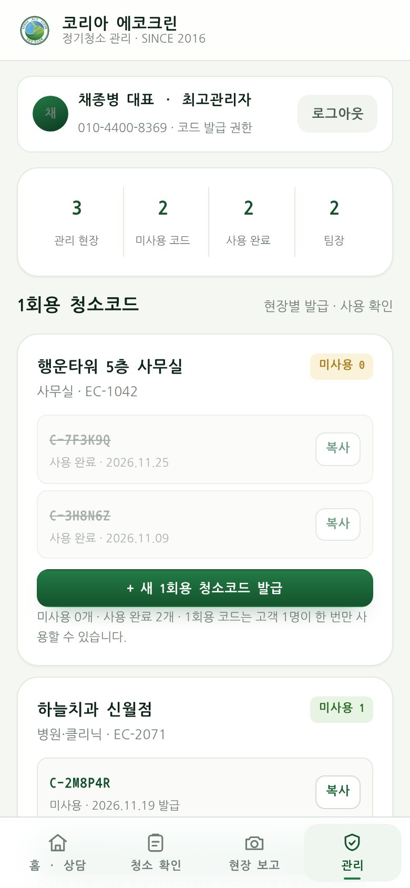
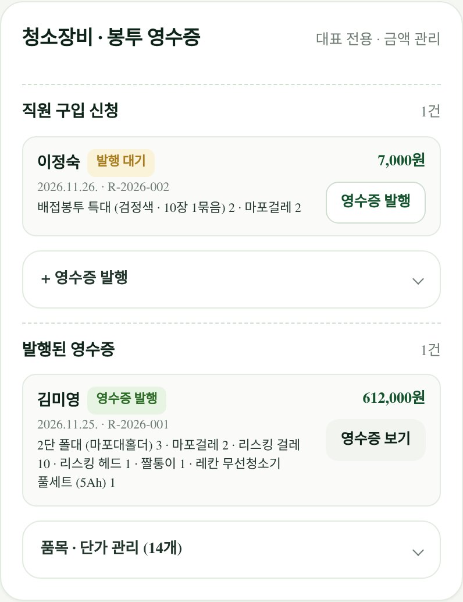
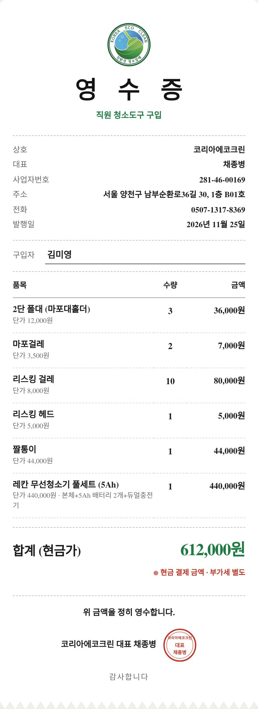
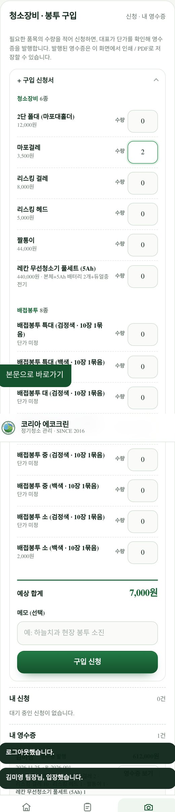
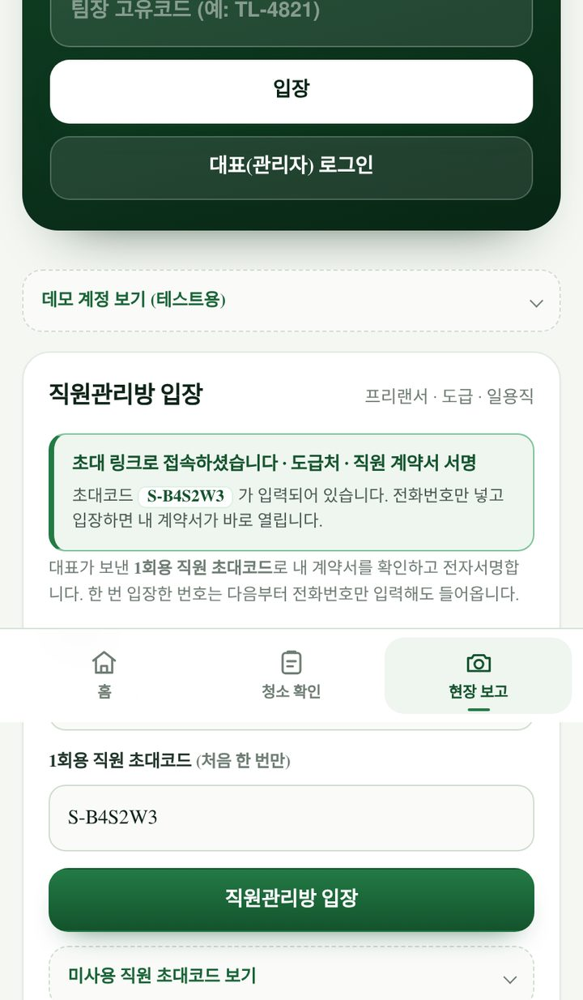
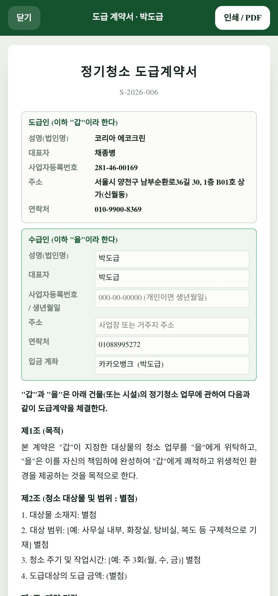
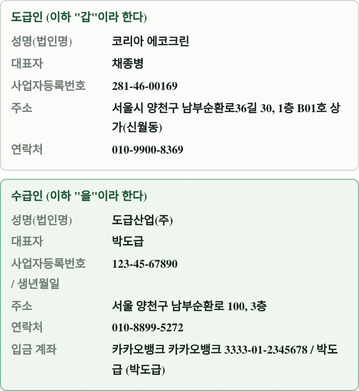

# 코리아 에코크린 — 현장 관리 PWA

사무실·병원·상가·헬스장 정기청소 전문 **코리아 에코크린**의 모바일 앱(PWA)입니다.
**빌드 도구 없이** HTML/CSS/JavaScript만으로 동작하고, **무료 호스팅**(GitHub Pages · Vercel · Cloudflare Pages)과
**무료 Supabase 플랜**에 그대로 올릴 수 있습니다. 서버 없이도 지금 바로 설치·테스트할 수 있도록
데이터는 기기 안(IndexedDB)에 저장됩니다.

- 브랜드: 코리아 에코크린 (대표 채종병)
- 전화 0507-1317-8369 · 이메일 koreaecoclean@naver.com
- 주소: 서울특별시 양천구 남부순환로36길 30, 1층 B01호 상가(신월동)
- 홈페이지: https://koreaecoclean.github.io/

---

## 1. 무엇이 들어 있나

| 탭 | 사용자 | 기능 |
| --- | --- | --- |
| **홈** | 전체 | 앱 입구 — 회사 로고, 현장 사진 갤러리, **청소 확인 · 현장 보고 · 관리** 바로가기, **회사 홈페이지 배너** |
| **청소 확인** | 고객 | **등록된 번호는 전화번호만**으로 / **처음 · 추가 인원은 전화번호 + 1회용 초대코드**로 **우리 현장 전용 방** 입장 → **① 견적**(견적서 시트 · 견적 시 오염 사진) · **② 계약**(표준 도급 계약서 전자서명·PDF · **고객사 사업자등록증 업로드/미리보기** · 특이사항) · **③ 관리**(3단계 비교 + 일자별 청소 보고) |
| **현장 보고** | 팀장 · 직원 | 전화번호+비밀번호+**팀장 고유코드** 또는 **1회용 직원 초대코드** 로그인 → **관리업장 · 계약서(본인) · 장비 · 봉투** 탭 → 현장 선택 시 **본인 도급 조건**(이 업장의 도급금액) + **현장 운영 정보**(청소 공정·출입방법·쓰레기 배출위치·주차방법) + **사진 3분류**·점검 항목·메모 보고(등록 후 대표 확인을 거쳐 고객사 제출). **장비 · 봉투**는 청소장비·배접봉투 구입 신청과 내 영수증(인쇄/PDF) — **구입 당사자 직원만** 보입니다 |
| **관리** | 최고관리자(대표) · 부관리자(본부장) | **최고관리자**: **보고 확인 · 고객사 제출**(팀장 보고 승인) · **관리자 모드 ↔ 직원 모드 전환** · 전체 매출 정리 · 고객 견적/계약 · 직원 계약(금액 포함) · **직원 평가(A~F)** · 직원방 · **청소장비·봉투 단가와 영수증 발행** · 현장/팀장/고객 관리 전부. **부관리자(본부장)**: 본인 담당 현장의 운영 정보와 내 계약서만 — 다른 직원의 관리·직원 평가·고객 계약서·견적서·금액은 표시되지 않습니다 |

- 보고를 등록하면 **최고관리자(대표) 확인 대기**로 등록되고, 대표가 확인해 **고객사에 제출**해야 고객 방에 표시됩니다.
- 각 고객사는 **자기 현장 기록만** 볼 수 있습니다(방 격리).
- 사진은 기기 안에서 1600px · JPEG로 자동 압축(장당 약 150KB)되어 저장 공간을 아낍니다.
- PWA: 홈 화면 설치, 오프라인 실행, 하단 탭 내비게이션, iOS 안전 영역 대응.

### 화면 미리보기 (실제 실행 화면)

| 홈 · 상담 | 청소 확인 (고객 방) | 현장 보고 (팀장) | 관리 (대표) |
| --- | --- | --- | --- |
|  |  |  |  |

### v2.3.0 — 견적 → 계약 → 현장, 직원 계약 · 직원방

**① 견적서 → 고객 초대 → 계약서 → 정기청소 현장 자동 등록 (최고관리자 전용)**

1. **관리 → 견적 · 계약 → 새 견적 등록**: 고객사·업종·소재지·담당자·연락처·사업자번호·세금계산서 이메일, 청소 주기/범위/추가 업무/면적, 월 계약금액·부가세·결제일·계약기간, 특약(제16조)·비고, **현장 오염상태 사진**.
2. 저장하면 **1회용 초대코드**(`Q-XXXXXX`)가 자동 발급되고 **[초대 문구 복사]**로 문자·카톡 문구를 바로 보낼 수 있습니다.
3. 고객은 `청소 확인` 탭에서 전화번호 + 초대코드로 입장 → **① 견적**에서 견적서 확인 → **[이 견적으로 계약 진행]**.
4. **② 계약**에서 표준 도급 계약서(제1조~제16조)를 확인하고 **전자서명(손글씨 패드)** → **[계약 체결 완료]**.
5. 체결과 동시에 **정식 정기청소 현장이 자동 등록**되고(계약금·계약일·청소 공정·첫 견적 오염 사진), **관리 → 전체 매출 정리**와 고객 방 **③ 관리**의 3단계 비교에 바로 반영됩니다.
6. 계약서·견적서는 **[인쇄 / PDF]** 로 A4 저장할 수 있습니다.

**결제 계좌**: 카카오뱅크 **3333-15-4406523** · 예금주 **채종병(코리아 에코크린)** (대표 지시로 우리은행에서 변경)

**② 직원 계약 · 직원방 (최고관리자 · 부관리자)**

- 직원 유형 4종: **도급(하도급)** · **프리랜서(3.3% 위수탁)** · **일용직** · **알바(시급)**
- 관리 → 직원 · 계약 관리에서 직원 등록 시 **1회용 직원 초대코드**(`S-XXXXXX`)가 발급됩니다. **[직원에게 발송]** 후 직원이 초대코드로 입장하면 **내 계약서**를 확인하고 전자서명합니다.
- **직원방**: 직원 목록에서 직원을 누르면 **계약서 · 관리업장 · 근무태도(A > B > C > D > E > F)** 세 목록이 열립니다. 최고관리자는 금액까지, 부관리자는 계약 유형·체결 상태·현장·근무태도만 봅니다.
- 일반 직원(팀장·프리랜서·일용직·알바)은 **본인 계약서와 배정 현장만** 보이고 다른 직원 목록은 보이지 않습니다.

**③ 권한표**

| 항목 | 최고관리자(대표) | 부관리자(본부장) | 팀장 · 직원 | 고객 |
| --- | --- | --- | --- | --- |
| 전체 매출 · 계약금 · 도급 · 수수료 · 순수 매출 | O | **X** | **X** | **X** |
| 견적서 · 고객 계약서 | O | **X** | **X** | 본인 것만 |
| 직원 계약 금액(도급·일당·시급) | O | **X** | 본인 것만 | **X** |
| 정기청소 도급계약서 · 별첨본 (을 정보·서명) | O | **X** | 본인 것만 | **X** |
| 직원방(직원 목록 · 근무태도) | O | O | **X** | **X** |
| 청소장비 · 배접봉투 단가 · 영수증 발행 | O | **X** | **X** | **X** |
| 장비 · 봉투 구입 신청 · 내 영수증 | O | **X** | 본인 것만 | **X** |
| 현장관리 & 체크 · 3분류 사진 보고 | O | O | 담당 현장 | **X** |
| 근무태도 A~F 등급 부여 | O | O | 본인 이력만 | **X** |

### v2.4.0 — 청소장비 · 배접봉투 구입 · 영수증

직원이 현장에서 쓰는 **청소장비 6종**과 **배접봉투 8종**을 앱에서 신청하고, 대표가 **영수증을 발행**하면 직원이 자기 폰에서 바로 **인쇄 / PDF** 로 받습니다.

| 대표 — 단가 관리 · 영수증 발행 | 영수증 시트 (A4 인쇄/PDF) | 직원 — 구입 신청 · 내 영수증 |
| --- | --- | --- |
|  |  |  |

**전자서명 — 서명 박스를 누르면 전용 서명 창**

| 서명 창 (S펜 · 손가락 · 마우스) | 정기청소 도급계약서 (실제 양식) |
| --- | --- |
|  |  |

- 고객 계약서·직원 계약서 모두 **서명 박스를 누르면 화면 전체를 쓰는 서명 창**이 열립니다. 서명하는 동안 페이지가 스크롤되지 않습니다.
- **S펜·스타일러스(pen) · 손가락(touch) · 마우스(mouse)** 를 PointerEvent로 모두 받고, 펜은 필압에 따라 선 두께가 바뀝니다. `touch-action:none` + `setPointerCapture`, devicePixelRatio 반영 고해상도 캔버스로 필기가 선명합니다.
- 서명 창에서 **[지우기] · [서명 적용]** — 적용을 눌러야 계약서에 서명이 들어가고, 그 다음 **[계약 체결] / [직원 서명 완료]** 로 체결합니다.

**정기청소 도급계약서 — 실제 도급인 양식 (도급 유형)**

- **갑(도급인) = 코리아 에코크린** (대표 채종병 · 281-46-00169 · 서울시 양천구 남부순환로36길 30, 1층 B01호 상가(신월동) · 010-9900-8369), **을(수급인) = 미정/직원**.
- 제1조(목적) ~ 제11조(소송관할) **원문 그대로**, 제4조는 **부가세 별도 · 익월 15일 지급 · 을 지정 계좌**.
- **별첨본**: 배정된 현장을 `대상물명 | 소재지 | 주기 | 시간 | 청소 범위 | 도급액(공급가·세액·합계)` 표로 그리고, 변동·정산 조항과 `"을"은 정기청소 수행업무에 대한 모든 내용을 확인하였습니까 □ 아니오 (서명) □ 네 (서명)` 문구를 넣었습니다. (PDF 샘플의 롯데몰·동방노보펌 같은 예시 데이터는 넣지 않습니다.)
- 직원은 초대코드로 들어와 **을 정보(상호·성명·사업자번호/생년월일·주소·연락처·입금 계좌)** 를 입력·확인하고 전자서명합니다.
- 대표는 **관리 → 직원 · 계약 관리 → [을 미정(공란) 도급계약서 생성 / 인쇄]** 로 바로 공란 계약서를 열어 인쇄·PDF 저장할 수 있습니다.

**기본 품목 (첨부 사진과 같은 단가)**

| 청소장비 | 단가 | | 배접봉투 (10장 1묶음) | 단가 |
| --- | --- | --- | --- | --- |
| 2단 폴대 (마포대홀더) | 12,000원 | | 특대 · 대 · 중 · 소 (검정색) | **미정 (대표가 입력)** |
| 마포걸레 | 3,500원 | | 특대 · 대 · 중 · 소 (백색) | **미정 (대표가 입력)** |
| 리스킹 걸레 | 8,000원 | | | |
| 리스킹 헤드 | 5,000원 | | | |
| 짤통이 | 44,000원 | | | |
| 레칸 무선청소기 풀세트 (5Ah) | 440,000원 | | | |

- **대표(관리 탭)**: 품목·단가 수정, 새 품목 추가/삭제, **영수증 바로 발행**(구입자 선택 또는 직접 입력 · 발행일 · 여러 품목 수량 · 자동 합계). 직원이 신청한 건은 **수량·단가를 확인하고 [영수증 발행]** 만 누르면 됩니다.
- **직원(현장 보고 → 장비 · 봉투)**: 필요한 품목의 수량을 적어 신청 → 발행된 **내 영수증**만 보이고 인쇄/PDF로 저장합니다. 다른 직원의 신청·영수증은 보이지 않습니다.
- **부관리자(본부장)와 고객 화면에는 장비·봉투 메뉴와 금액이 전혀 나오지 않습니다.**
- 영수증에는 상호·대표·사업자번호·주소·전화·발행일·구입자·품목별 단가/수량/금액·**합계 (현금가)**·`※ 현금 결제 금액 · 부가세 별도`·`위 금액을 정히 영수합니다`·대표 직인이 그대로 인쇄됩니다. 단가가 미정인 봉투가 섞여 있으면 영수증에 안내가 붙습니다.
- 데모: **김미영 팀장 영수증 1건(6품목 · 612,000원)** 과 **이정숙 팀장 발행 대기 신청 1건**이 들어 있어 바로 눌러볼 수 있습니다.

### v2.6.4 — 회사 직인 · 을 정보 · 관리팀장별 관리업장 · 계약서 별첨 자동 추가

**① 회사 도장(직인) 이미지**

- 대표가 보낸 도장 사진에서 검은 배경을 완전히 빼고 빨간 인영만 남긴 **투명 PNG**(`assets/company-seal.png`)를 서식에 넣었습니다.
- **모든 계약서·영수증의 ‘갑’ 날인 자리**에 같은 도장이 들어갑니다 — 도급계약서(당사자·서명란), 별첨본(갑 서명), 고객 계약서(을 코리아 에코크린 대표자), 견적서 하단, 프리랜서·일용직·알바 계약서(사업주 갑), 청소장비·봉투 영수증.
- 기존의 글자 원형 도장(`(인)`)은 회사 도장 자리에서 모두 걷어냈습니다. 을(수급인) 자리는 본인 날인 자리라 점선 `(인)` 표시만 남깁니다.

**② 도급계약서 ‘을’ 정보 — 블링블링크린**

- 이용구 부장 계약서(`S-2026-005`)의 을 정보: **회사명(상호) 블링블링크린**, 대표자 이용구, **사업자등록번호(주민번호)는 빈칸**입니다. 기존 주민번호는 지웠습니다.
- 계약서 항목 이름도 **회사명(상호)** · **사업자등록번호 / 주민등록번호** 로 바꿔 화면에서 바로 고칠 수 있습니다.

**③ 별첨본 확인 칸이 실제로 눌립니다**

- `"을"은 정기청소 수행업무에 대한 모든 내용을 확인하였습니까?` 아래 **□ 아니오 / □ 네** 를 누르면 **☑** 로 바뀌고 초록색으로 표시됩니다.
- 대표·을 **양쪽 계약서 창**에서 눌리고, 같은 칸을 다시 누르면 취소됩니다. 선택은 계약서 데이터(`annexAck`)에 저장되어 **창을 닫았다 열어도 유지**됩니다(체결된 계약서는 읽기 전용).

**④ 관리팀장별 관리업장 (대표 · 부관리자)**

- `현장 보고` → `관리업장`에 들어가면 **관리팀장 카드**가 먼저 나옵니다(이름·직함·배정 업장 수, 예: 김미영 팀장 1곳 · 이용구 부장 2곳 · 이정숙 팀장 1곳) + **전체 업장 보기**.
- 팀장을 누르면 **그 팀장의 관리업장만** 표시되고 `← 팀장 목록`으로 돌아갈 수 있습니다. 현장을 누르면 기존처럼 사진·점검 보고서가 열립니다.
- 같은 화면에 **팀장과의 계약서**(계약번호·체결 상태·업장 수)가 함께 붙어 **[계약서 열기]** 로 바로 확인합니다. `계약서` 탭에서도 팀장 계약서 목록을 봅니다(금액은 표시하지 않습니다).
- 일반 팀장·부장 본인으로 로그인하면 예전처럼 **본인 배정 업장만** 바로 보입니다.

**⑤ 새 업장은 팀장 계약서 별첨에 자동으로 추가**

- 관리 → 새 현장 등록에서 담당 팀장을 고르거나, 현장의 담당 팀장을 바꾸면 그 팀장의 계약서 `siteIds`(별첨 표)에 **현장이 자동으로 들어갑니다**.
- **체결된 계약서**는 금액·서명·기간을 건드리지 않고 별첨 줄만 더합니다(금액이 비어 있는 새 줄은 공란). 담당이 아닌 팀장의 **미체결** 계약서에서는 빠집니다.

### v2.11.1 — 현장 도착 = 청소 시작 시간 · 청소 완료 = 종료 · 소요 시간

> 2026-11-28 요청 "현장도착 누르면 시작시간등록". **새 컬렉션 · 스키마 변경 · 운영 데이터 마이그레이션 없이** 기존 `sites.visits` 의 `at`(기록 시각)을 청소 시작 · 종료 시간으로 그대로 씁니다.

**① 현장 도착 = 청소 시작 시간 등록**

- 팀장이 **[현장 도착]** 을 누르면(GPS 인증이든 사유를 남긴 예외 기록이든) 그 시각이 그날 일정의 **청소 시작 시간**으로 즉시 등록됩니다.
- 팀장 일정 카드: 예정 시간 아래 **`시작 오전 7:47` / `종료 —`** 칸이 생기고, 도착하면 초록색 **`✓ 시작 등록됨 · 오전 7:47`** 과 함께 **[청소 완료 (종료 시간 등록)]** 만 크게 남습니다. 시작을 잘못 찍었으면 작은 **[시작 시간 다시 기록]** 으로 고칩니다(확인창 1회).

**② 청소 완료 = 종료 시간 + 소요 시간**

- **[청소 완료]** 를 누르면 종료 시각이 등록되고 **`소요 1시간 25분`** 이 함께 계산 · 표시됩니다(카드 요약: `청소 완료 · 시작 오전 7:47 → 종료 오전 9:12 (소요 1시간 25분)`). 완료 뒤에도 작은 **[완료 시간 다시 기록]** 이 있습니다.
- **야간 일정**(예: 22:30 ~ 05:30)은 도착과 완료가 서로 다른 날짜에 찍히므로 **12시간 안의 짝**을 이어 소요 시간을 계산합니다(다음 날 새벽 완료 → 전날 일정이 완료로 정리).
- 현장 보고 등록 시 당일 시작 · 종료 기록이 있으면 보고서에 **`workStartAt` · `workEndAt` · `workDurationMin`** 으로 자동 연결되고, 보고 화면에 `현장 도착 · 청소 완료 기록` 상자와 **[소요 시간 1시간 25분로 채우기]** 가 나옵니다. v2.11.0 이전 보고서는 새 필드가 비어 있어 그대로 동작합니다(하위 호환).

**③ 화면 표시**

- **대표 「일정 · 현장 도착」**: `예정 22:30 ~ 05:30` 아래 **`실제 시작 오전 10:41 · 종료 오전 11:15 (소요 34분)`**. 최근 현장 기록도 `시작` · `종료 · 소요` 로 표시합니다(기록 시각을 기기 시간대(KST)로 변환 — 이전에는 UTC 로 잘려 보이던 부분 수정). 보고 확인 카드에 **`시작 오전 7:47 → 종료 오전 9:12 · 소요 1시간 25분`**.
- **고객 「방문 일정」**: 예정 시간 옆에 **`시작 오전 7:47` / `완료 오전 9:12 (1시간 25분)`**, 방문 보고에도 같은 줄. 좌표 · 거리 · 예외 사유 · 담당자 이름은 계속 비노출입니다.

**④ 권한 (v2.8.2 · v2.9.0 · v2.11.0 유지)**

- 시작 · 종료 시각은 업장 배정 직원 · 대표만 기록하고, 고객에게는 **시각만** 넘깁니다. 팀장에게 다른 직원의 좌표는 넘기지 않습니다.

**검증 (2026-11-28)**

| 테스트 | 결과 |
| --- | --- |
| `tests/test_v2111_worktime.py` (신규) | **62/62** — 시간 도우미 · 도착=시작 · 완료=종료 · 소요 · 야간 12시간 짝 · 재기록 · 보고서 자동 연결 · 하위 호환 · 권한 · 라이브 63행 보존 |
| `tests/test_v2111_render.py` (신규) | **46/46** — 대표 일정 · 최근 기록 · 보고 확인 카드 · 팀장 카드 3상태 · 보고 화면 · 고객 방문 일정 · 기존 보고서 |
| `tests/browser_v2111.py` (신규) | **42/42** — 실제 Chromium: 좌표 저장 → 도착(시작 등록) → 완료(소요 1시간 25분) → 보고 자동 연결 → 대표 확인 → 고객 (콘솔 오류 0) |
| 기존 18종 + `run_tests.py` | **1,464/1,464** |
| `browser_test` · `browser_stage4` · `browser_stage5` | 273/273 · 40/40 · 50/50 |
| `check_static` · `run_views` | ALL PASSED |

서비스 워커 `CACHE_VERSION` **v2.11.1**.

### v2.11.0 — 일정 관리 · GPS 위치 인증 (통합 운영 앱 5단계)

> 기획서 14장(일정 관리) · 15장(현장 도착 확인). **새 컬렉션 · 스키마 변경 · 운영 데이터 마이그레이션 없이** 기존 `sites` 안에 일정 설정(`schedule`) · 날짜별 변경(`scheduleOverrides`) · 현장 기록(`visits`)을 담았습니다.

**① 일정 자동 생성 · 주간 조회**

- 업장의 **청소공정 매뉴얼 요일 · 청소 주기**에서 일정을 자동으로 만듭니다. 설정을 저장하지 않은 기존 업장도 바로 일정이 나옵니다.
- 대표는 **전체 업장 + 팀장별 필터**, 팀장은 **본인 배정 업장**, 고객은 **자기 업장** 일정만 봅니다.
- 상태: **예정 / 진행 중(도착 인증) / 완료(완료 기록 또는 그 날짜 보고) / 미방문(지연) / 휴무 · 일정 변경**.

**② 대표 — 일정 · 위치 설정**

- 관리 화면 맨 위 **「일정 · 현장 도착」**: 오늘 일정 카드(업장 · 시간 · 담당 · 상태 · 위치 인증/미인증 배지 · 도착/완료 시각), 상태별 합계, 팀장별 필터, 다음 일정, 월간 일정(이전/다음 달).
- **「일정 · 위치 설정 (업장별)」**: 요일 체크 · 시작/종료 시간 · 허용 반경(기본 200m) · 업장 좌표(**［현재 위치로 좌표 등록］** 또는 직접 입력) · 위치 메모.
- **날짜별 일정 변경**: 휴무 · 보강 추가 · 시간 변경 + 사유. 같은 날짜는 새 값으로 바뀌고, 바뀐 칸은 업장 이력에 남습니다.

**③ 팀장 — 현장 도착(GPS) · 청소 완료**

- `현장 보고` → **「일정」 탭**에 오늘 일정 카드와 **[현장 도착 (GPS 확인)] / [청소 완료]**, 이번 주 · 월간 일정.
- 누르면 브라우저 위치로 **현재 좌표 · 거리(m) · 반경 안 여부 · 시각**을 기록하고, 카드에 `위치 인증 · 45m` 처럼 표시합니다.
- 위치 권한 거부 · 미지원 · 실내 오차로 확인이 안 되면 **사유(권한 거부/미지원/실내 오차/현장 사정/기타) + 메모**로 예외 기록합니다. 기록 자체를 막지 않되, 대표 화면에는 **‘위치 미인증’** 배지로 정확히 표시합니다.
- 위치는 **도착/완료를 누를 때 한 번만** 기록하고 근무 중 계속 추적하지 않습니다.

**④ 권한 (v2.8.2 · v2.9.0 유지)**

- 일정 설정 · 날짜 변경은 **대표만**. 현장 기록은 **그 업장에 배정된 직원 또는 대표만**(타 업장 · 고객 · 비로그인 차단).
- 팀장 화면에는 고객 계약 금액 · 견적 · 다른 업장 일정이 없고, 고객 화면에는 **방문 날짜 · 시간 · 상태만** 있습니다(좌표 · 거리 · 직원 위치 기록 없음). 본부장 화면에는 전체 일정 · 위치 설정이 나오지 않습니다.

**검증 (2026-11-28)**

| 테스트 | 결과 |
| --- | --- |
| `tests/test_stage5_schedule.py` (신규) | **132/132** — 요일/시간 해석 · 거리/반경 · 기본값 · 상태 5종 · 권한 3역할 · 설정/날짜변경/이력 · GPS/예외 기록 · 라이브 63행 보존 |
| `tests/test_stage5_render.py` (신규) | **80/80** — 관리 일정·설정 상자, 팀장 일정 탭·월간, 고객 방문 일정, 본부장 비노출 |
| `tests/browser_stage5.py` (신규) | **50/50** — 실제 Chromium + 가짜 GPS: 좌표 저장 → 도착(위치 인증) → 권한 거부 후 완료(예외 사유) → 대표 확인 → 고객 (콘솔 오류 0) |
| 기존 16종 | 1,144/1,144 |
| `run_views` · `browser_test` · `browser_stage4` | ALL PASSED · 273/273 · 40/40 |
| `check_static` | ALL PASSED |

합계 **1,356개 파이썬 검사 + 363개 브라우저 검사** 통과. 라이브 DB 테스트 데이터 0건(스냅샷 63행 그대로). 서비스 워커 `CACHE_VERSION` **v2.11.0**.

### v2.10.0 — 업장 인수인계 · 팀장 배정 수락/거절 · 도급계약 자동 생성 (통합 운영 앱 4단계)

> 기획서 10장(업장 인수인계) · 11장(팀장 선정·배정) · 12장(팀장 계약 자동 생성). **새 컬렉션·스키마 변경·운영 데이터 마이그레이션 없이** 기존 `sites` 안에 인수인계(`handover`) · 출입 보안정보(`secret`) · 배정 요청(`assignments`)을 담았습니다.

**① 업장 인수인계 — 대표가 관리방에서 입력·저장·전달 (기획서 10장)**

- 관리 → 업장 카드 → **「인수인계 · 팀장 배정」** 상자에 현장 주소 · 출입 방식(공동현관/카드키/비밀번호/열쇠/지문 방식) · 출입 방법(시건장치) · 출입 담당 · 출입 가능 시간 · 주의사항 · 경비실/관리실 · 주차 · 쓰레기 배출(위치·시간·분리수거·음식물) · 청소도구/비품 보관 위치 · 시설(물·전기·고장 연락처) · 청소 요일/시간/완료 목표/범위 · 주의사항을 적습니다.
- **현장 사진 연결**: 그 업장의 첫 견적 · 첫 대청소 · 방문 구역 사진 중 골라 인수인계에 붙입니다(사진을 복사하지 않고 원본을 가리킴).
- **도급금액 · 지급일 · 지급 조건**: 저장하면 업장의 도급금액(`site.contract.subcontractAmount`)과 팀장 「내 도급 조건」도 같은 값으로 맞춰집니다(같은 내용을 두 번 입력하지 않음).
- **인수인계 이력**: 저장할 때마다 `version`(v1, v2 …)과 바뀐 칸의 전/후 값을 `handoverHistory` 에 남기고, 업장 변경 이력에도 함께 기록합니다. 같은 값으로 다시 저장하면 버전이 오르지 않습니다.
- **항목별 확인** 체크(출입 · 쓰레기 · 주차 · 시설 · 청소 조건)를 관리합니다.
- 출입 · 쓰레기 · 주차 요약은 기존 「현장 운영 정보」(`site.ops`)에도 같은 값으로 반영됩니다.

**② 출입 비밀번호는 일반 업장 정보와 분리 (기획서 10장 보안)**

- 비밀번호 · 보안 메모는 `site.secret` 으로 따로 저장합니다. **비밀번호 값은 인수인계 이력·업장 목록·팀장 화면에 남지 않습니다.**
- 배정이 확정된 팀장만 **［보기］** 로 열람할 수 있고, **누가 언제 열람했는지**가 `secret.log` 와 업장 이력에 남습니다. 관리 화면도 현재 값은 ［현재 비밀번호 보기］로만 확인합니다.
- 지문은 원본을 저장하지 않고 **출입 방식만** 기록합니다(기획서 10장).

**③ 팀장 배정 요청 — 대표 → 팀장 (기획서 11장)**

- 인수인계를 저장한 뒤 관리팀장 · 도급금액 · 지급일 · 지급 조건 · 메모를 담아 **［팀장 배정 요청 보내기］**. 요청에는 보낸 시점의 인수인계 내용(v번호)이 함께 복사됩니다.
- 요청 상태: **배정 제안 중 → 수락 완료 / 거절됨 / 철회됨 / 새 요청으로 대체**. 같은 팀장에게 다시 보내면 새 건을 만들지 않고 조건만 갱신하고, 다른 팀장에게 보내면 이전 대기 요청은 ‘대체’로 보존합니다.
- 수락된 배정이 있는 업장은 다른 팀장에게 재배정할 수 없고(철회 불가), 계약까지 서명된 업장은 재배정이 막힙니다. 
- **거절하면** 사유(일정·거리·금액·업무 범위·현장 조건·기타 직접 입력)와 일시가 기록되고, 대표는 **바로 다른 팀장에게 재배정**할 수 있습니다.

**④ 팀장 「내 배정」 — 인수인계 + 도급금액만 보고 수락/거절**

- `현장 보고` 에 **「내 배정」** 탭(수락 대기 건수 표시). 카드에는 **주소 · 출입 · 경비실 · 주차 · 쓰레기 · 비품 보관 · 시설 · 청소 요일/시간/범위 · 현장 사진 · 도급금액 · 지급일** 만 나옵니다.
- **고객 계약 금액 · 고객 계약서 · 견적서 · 고객 개인정보 · 다른 팀장의 요청은 표시되지 않습니다**(저장소 호출에서도 차단). 수락 전에는 그 업장이 관리업장에 열리지 않고 비밀번호도 보이지 않습니다.
- ［배정 수락］→ 도급계약서 자동 생성 → **［확인 · 서명］** → 담당 확정. ［거절］은 사유를 적어 보냅니다.

**⑤ 수락 → 팀장 도급계약서 자동 생성 · 서명 → 담당 확정 (기획서 12장)**

- 수락하면 그 업장 · 도급금액 · 지급일(정산일) · 청소 범위 · 작업 요일/시간 · 청소 공정 · 안전(주의)사항 · 지급 조건이 들어간 **정기청소 도급계약서**가 `S-연도-번호` 로 자동 생성되어 업장·팀장 계정에 연결됩니다(상태: 서명 대기). 갑 직인 · 을 전자서명 · 별첨본(관리업장 표) · 별첨 확인 **네/아니오** 는 기존 규칙 그대로입니다.
- 팀장이 서명하면 **담당 팀장이 정식 확정**(`site.manager`·`assignee`)되고, 그 업장의 **현장 보고 · 요일별 체크리스트가 즉시 활성화**됩니다(계정 배정 + 업장 이력 「팀장 배정 확정 · 현장 보고 활성화」).
- 업장의 도급금액이 계약 금액과 다르면 서명 시점에 계약 금액으로 맞춰 「내 도급 조건」과 어긋나지 않게 합니다.

**⑥ 권한 (v2.8.2 · v2.9.0 유지)**

- 인수인계 · 보안정보 저장과 배정 요청·철회는 **대표만**. 수락/거절은 **본인 계정만**(대표도 남의 이름으로 수락 불가).
- 부관리자(본부장) · 다른 팀장 · 고객 화면에는 인수인계 · 배정 · 보안정보가 나오지 않고, 고객에게 내려가는 업장(`siteForCustomer`)에도 새 필드가 없습니다.

**검증 (2026-11-28)**

| 테스트 | 결과 |
| --- | --- |
| `tests/test_stage4_handover.py` (신규) | **149/149** — 인수인계 저장·버전·이력·사진 연결·운영정보 동기화, 보안정보 분리·열람 기록, 배정 요청 검증·대체·철회, 수락 시 계약 자동 생성(금액·지급일·범위·요일), 서명 후 담당 확정·보고 활성화, 거절 사유·재배정, 권한·비노출, 라이브 63행 보존 |
| `tests/test_stage4_render.py` (신규) | **105/105** — 관리 인수인계·배정 상자, 팀장 「내 배정」 카드(금액·인수인계·사진·수락/거절), 수락 완료·계약서 연결, 업장 인수인계 카드·비밀번호 가림, 본부장·고객 비노출 |
| `tests/browser_stage4.py` (신규) | **40/40** — 실제 Chromium: 대표 인수인계·비밀번호 저장 → 배정 요청 → 이아름 팀장 수락 → 도급계약서 자동 생성 → 서명 → 담당 확정·관리업장 개방·비밀번호 열람 기록 (콘솔 오류 0) |
| 기존 15종 | 890/890 — `run_tests` 204 · `stage3_contract` 104 · `quote_survey` 80 · `quote_render` 73 · `role_permissions` 61 · `leader_migration` 58 · `stage3_render` 55 · `data_links` 52 · `staff_accounts` 52 · `fastfive` 49 · `staff_account_render` 42 · `contract_migration` 20 · `admin_render` 15 · `supply_migration` 13 · `admin_migration` 12 |
| `run_views` · `browser_test` | ALL PASSED · 273/273 (콘솔 오류 0) |
| `check_static` | ALL PASSED (JS·CSS·경로·권한 분리) |

합계 **1,144개 파이썬 검사 + 313개 브라우저 검사** 통과. 라이브 DB에는 테스트 데이터를 넣지 않았습니다(스냅샷 63행 그대로, 새 필드도 자동으로 생기지 않음). 서비스 워커 `CACHE_VERSION` **v2.10.0**.

### v2.9.0 — 고객사 초대 · 계약 자동 연동 · 업장 관리방 (통합 운영 앱 3단계)

> 기획서 5장(고객사 초대) · 8장(고객사 계약) · 9장(계약 완료 후 업장 관리방). 새 컬렉션 없이 기존 `sites`·`quotes`·`contracts`·`accounts` 위에 붙였습니다.

**① 고객사 초대 — 링크 · 문구 · 문자/메일 한 번에**

- 관리 화면에 **「고객사 초대」** 패널이 생겼습니다. 현장 방문·견적을 저장하면 바로 초대 대상이 올라오고, 견적마다 **1회용 코드 · `#invite=` 링크 · [문구 복사] · [링크 복사] · [문자] · [메일] · [재발급]** 이 있습니다.
- 견적 카드 · 업장 카드에도 같은 초대 문구/링크 버튼이 붙습니다. 문자는 `sms:`(담당자 번호), 메일은 `mailto:`(담당자 이메일 → 세금계산서 이메일) 로 열립니다.
- 문구에는 고객사명 · 링크 · 1회용 코드 · 문의 번호가 들어갑니다(`js/invite.js` 한 곳에서 생성).

**② 담당자 가입/인증 — 1회용 코드 + 담당자 정보 확인·등록**

- 고객 로그인 화면에 **직함 · 이메일** 칸이 생겼습니다. 초대코드로 들어오면 이름·직함·이메일이 계정에 등록됩니다.
- 견적 방·업장 방 상단에 **「담당자 정보」** 패널 — 이름 · 직함 · 이메일을 확인해 저장하면 계정, 진행 중인 견적서(담당자·연락처·이메일), 계약서(담당자)에 같은 값이 반영됩니다. 잘못된 이메일·다른 고객 계정 수정은 거절합니다.

**③ 고객은 자기 업장만 (기획서 5장)**

- 고객이 열 수 있는 업장 = **자기 계정에 연결된 업장** + **초대받아 진행 중인 견적의 업장**뿐입니다.
- 견적서·계약서도 고객은 자기 것만 목록에 나오고, 남의 id로 열어도 `permission-denied` 입니다. 고객에게 내려가는 업장 객체는 `siteForCustomer` 로 정리해 계약 금액·내부 운영 정보를 빼고 넘깁니다.
- 직원(관리팀장·본부장)의 v2.8.2 제한은 그대로 — 견적서·고객 계약서·금액은 화면에서도 저장소 호출에서도 막힙니다. 계약서 수정·발송·갱신·종료는 대표만 할 수 있습니다.

**④ 견적 확정(대표 승인) → 계약서 자동 생성 (기획서 8장 13가지)**

- 고객사명 · 사업자등록번호 · 대표자 · 주소 · 담당자 · 계약 금액 · 청소 주기 · 청소 범위 · 계약 시작일 · 계약 종료일 · 작업시간 · 특약사항 · 계약 담당자가 견적·현장 방문 기록에서 그대로 옮겨집니다.
- 견적서·계약서 앞에 **「계약 정보 (견적에서 자동 연동)」** 표가 붙어 무엇이 자동으로 채워졌는지 바로 보입니다. 업장에서 대표자·사업자번호를 고치면 연결된 견적서의 빈 칸도 함께 채워집니다.

**⑤ 전자서명 · 서명 증빙 · 문서 무결성 해시**

- 고객이 스마트폰(스펜·손가락)으로 서명하면 **서명자 · 직함 · 연락처 · 서명 일시 · 서명 방식 · 문서 해시**가 저장됩니다.
- 문서 해시는 서명 시점의 계약 내용(13가지 + 공급자 정보)을 SHA-256(없는 기기에서는 간이 해시)으로 고정합니다. 시트의 **[문서 확인값 검증]** 으로 지금 내용과 저장된 해시가 같은지 확인하고, 다르면 경고합니다. 고객 계약 탭에도 서명 증빙이 보입니다.

**⑥ 계약 상태 · 수정 · 변경 이력**

- 상태: **작성 중(초안) → 고객 확인 대기(발송) → 체결 완료(서명) → 갱신 완료 / 계약 종료**. 시트 위 배지와 업장 연결 정보에 표시됩니다.
- **서명 전 계약 수정**: 금액 · 작업시간 · 기간 · 주기 · 특약 · 계약 담당자를 시트에서 고치고 저장합니다. 바뀐 항목은 `history[]` 에 전/후 값으로 남습니다.
- **계약 갱신**: 기간·금액을 정해 [계약 갱신서 만들기] → 기존 계약서는 ‘갱신 완료’로 보관되고 새 초안이 만들어집니다(업장·견적 연결도 새 계약서로). **계약 종료**: 종료일·사유를 남기면 업장 관리방이 닫히고 기록은 보관됩니다.
- 체결된 계약서는 수정·재서명할 수 없고, 갱신·종료된 계약서에는 다시 서명할 수 없습니다.

**⑦ 계약 체결 = 업장 관리방 자동 생성 (기획서 9장)**

- 서명과 동시에 그 업장(`siteId`)의 관리방이 열립니다(`site.room`). 고객사 정보 · 계약서 · 견적서 · 최초 현장 사진 · 평수 · 주기 · 청소 공정이 **다시 입력 없이** 이어집니다.
- 견적 방에 있던 고객 계정은 새 업장 방으로 옮겨지고 입장 권한이 생깁니다. 계약 담당자 번호로 이미 계정이 있으면 그 계정도 연결합니다.
- 현장 방문 구역 사진은 첫 견적 사진(①단계)으로, 구역 체크는 청소 범위·청소 공정으로 넘어갑니다. 업장 이력에 「고객 계약 체결 · 업장 관리방 생성」이 남고, 업장 연결 정보에 **관리방 운영 중 · 서명 증빙**이 표시됩니다.

**검증 (2026-11-27)**

| 테스트 | 결과 |
| --- | --- |
| `tests/test_stage3_contract.py` (신규) | **104/104** — 초대 문구/링크/문자·메일, 담당자 등록, 고객 접근 범위, 13가지 자동 연동, 서명·해시(변조 감지), 계약 수정 이력·갱신·종료, 관리방 자동 생성, 라이브 63행 보존 |
| `tests/test_stage3_render.py` (신규) | **55/55** — 초대 패널, 계약서 자동 연동 표·관리 블록, 서명 증빙, 고객 담당자/계약/관리 탭, 직원 화면 비노출 |
| 기존 13종 | 731/731 — `run_tests` 204 · `quote_survey` 80 · `quote_render` 73 · `role_permissions` 61 · `data_links` 52 · `staff_accounts` 52 · `fastfive` 49 · `staff_account_render` 42 · `leader_migration` 58 · `contract_migration` 20 · `admin_render` 15 · `supply_migration` 13 · `admin_migration` 12 |
| `run_views` · `browser_test` | ALL PASSED · 273/273 (콘솔 오류 0) |
| `check_static` | ALL PASSED (JS·CSS·경로·권한 분리) |

합계 **890개 파이썬 검사 + 273개 브라우저 검사** 통과. 라이브 DB에는 테스트 데이터를 넣지 않았습니다(스냅샷 63행 그대로). 서비스 워커 `CACHE_VERSION` **v2.9.0**.

### v2.8.2 — 직원 열람 권한 엄격 제한 (2026-11-27 대표 요청)

> "직원들은 남의 관리를 볼 수 없음 · 직원평가도 못 봄 · 본인이 관리하는 업장의 정보만 볼 수 있으며, 계약서·견적서도 못 보고 정해진 도급가와 청소공정 등 제한된 정보만 확인"

**① 화면 — 직원(관리팀장 · 부관리자)은 본인 배정 업장만**

- `현장 보고`의 **팀장 목록 · ‘전체 업장 보기’ · 팀장별 관리업장 디렉토리**를 없앴습니다. 대표 화면에서만 열립니다.
- 부관리자(본부장)도 직원과 같은 범위입니다. 관리 탭에는 **본인 담당 현장 + 내 계약서**만 나오고, 예전의 「현장관리 & 체크 · 직원관리 & 체크」 패널과 근무태도 체크는 없어졌습니다.
- 배정되지 않은 업장은 **딥링크(`openSite`)** 로도 열리지 않고, 저장소(`store.getSiteFor`)에서도 `null` 입니다.
- 다른 직원의 보고는 목록·요약에서 빠지고, 현장별 ‘최근 7일’ 집계도 본인 업장 기준입니다.

**② 직원 평가(A~F) — 대표만**

- 직원 화면의 **근무태도 탭**을 없앴고, 직원방(`staffRoomTemplate`)의 평가 등급·체크·이력도 `canSeeEvaluation`(대표)일 때만 그립니다.
- `store.listStaffChecks`·`store.addStaffCheck`는 직원 세션이 호출하면 `permission-denied` 로 거절합니다. 부관리자는 더 이상 등급을 매길 수 없습니다.

**③ 고객 계약서 · 견적서 · 고객 금액 차단**

- 직원이 `견적서`·`고객 계약서` 시트를 열려 하면 “대표(최고관리자)만 볼 수 있습니다” 안내로 막습니다.
- 다음 호출은 직원(actor)에게 `permission-denied`: `listQuotes` · `getQuote` · `listAgreements` · `getAgreement` · `revenueSummary` · `listStaffChecks` · `addStaffCheck` · `listAccounts` · `listRoomCodes` · `listGrants` · `resetDemo` · `listStaffContracts`(본인 것만) · `getStaffContract`(본인 것만) · `listSupplyOrders`(본인 것만).
- 직원 화면에 내려가는 업장 객체는 `store.siteForStaff` 로 정리됩니다 — `contractAmount`·`feeAmount`·`netProfit`·`contractDate`·`billingDay`·고객사명·사업자번호·세금계산서 메일·특이사항·사업자등록증·변경 이력·견적/계약 연결(`quoteId`·`contractId`·`survey`)은 **처음부터 전달되지 않고**, `staffPay.amount`(본인 도급가)만 남습니다.

**④ 직원이 볼 수 있는 제한 정보 (그대로 유지)**

- 현장 화면 위에 **「내 도급 조건」** 카드 — 이 업장의 도급금액(예: 청량리 동방노보펌 350,000원 · 마루가메우동 1,600,000원).
- **청소공정 매뉴얼**(요일별 작업표) · 출입방법 · 쓰레기 배출위치 · 주차방법 · 사진 3분류 보고.
- **본인 도급계약서** 열람·전자서명(초대 링크 `#invite=S-…`) — 다른 직원의 계약서 id로는 열리지 않습니다.
- 데모 초기화 버튼은 직원 화면에서 숨기고 `store.resetDemo` 도 직원 세션을 거절합니다(서버 데이터 보호).

**⑤ 대표 화면은 그대로**

- 전체 업장 · 견적 · 고객 계약 · 팀장 계약 · 직원 평가 · 매출 · 청소장비/영수증 모두 기존과 같습니다.
- 테스트: `tests/test_role_permissions.py` 신규 61개(직원 3명 렌더 + 저장소 차단/허용), 기존 670개 · `run_views` · `browser_test` 273개 · `check_static` 통과. 서비스 워커 `CACHE_VERSION` **v2.8.2**.

### v2.8.1 — 관리자 모드 직원 등록 · 코드 설정 (2026-11-27 대표 요청)

관리 → **「직원 등록 · 코드 설정」** 에서 대표가 직접 직원 계정을 만들고 고칩니다.

- **새 직원 등록**: 이름 · 직책 · 전화번호(로그인 ID) · 비밀번호 · 팀장 고유코드 · 역할(관리팀장 / 부관리자(본부장)) · 담당 현장을 정해 저장합니다.
  - **고유코드 자동생성**(`TL-0000`) · **비밀번호 만들기** 버튼, 직접 입력 모두 지원합니다.
  - 저장하면 `accounts` 에 즉시 들어가 서버(Supabase)와 동기화되고, 직원은 **전화번호 · 비밀번호 · 고유코드**로 바로 현장 보고에 로그인합니다.
- **기존 직원 수정**: 이름 · 직책 · 전화번호 · 비밀번호(비우면 유지) · 고유코드 · 역할 · 담당 현장 · 사용 중지/재개. 비밀번호 값은 이력에 남기지 않고 ‘변경’만 기록합니다.
- **로그인 안내 복사**: 그 직원에게 보낼 전화번호·비밀번호·고유코드 문구를 한 번에 복사합니다.
- **중복 방지**: 이미 쓰는 전화번호·고유코드는 저장되지 않고, 짧은 비밀번호·`TL-0000` 형식이 아닌 코드도 거절합니다.
- **공개 데모 목록 보호**: 실제 직원·대표·본부장 계정은 `demoHidden: true` 로 공개 로그인 화면의 데모 목록에 오르지 않으며, 새 계정도 기본으로 숨김입니다. 관리자/현장 보고 로그인 화면의 예시 코드도 `TL-0000` 으로 바꿨습니다.
- 기존 계정과 계약서(`S-2026-005`·`S-2026-006`)는 수정·삭제하지 않습니다. 서비스 워커 `CACHE_VERSION` **v2.8.1**.

### v2.8.0 — 현장 방문 · 구역별 사진 · 맞춤 견적 자동 산출 · 대표 승인 (통합 운영 앱 2단계)

기획서 4·6·7장(2단계: 견적 시스템) 작업입니다. 기존 견적·계약·현장 화면은 그대로 두고, **방문 → 사진 → 체크 → 자동 산출 → 승인 → 계약** 흐름을 기존 구조 위에 붙였습니다.

**① 현장 방문 등록 (관리 → 「현장 방문 · 자동 견적」)**

- 고객사명 · 사업장명 · 주소 · 담당자 · 연락처 · 방문일 · 견적 담당자 · 현장 위치 · 면적(평수) · 청소 주기 · 예상 작업시간 · 현장 난이도 · 작업 인원 예상 · 청소 구역 · 현장 특이사항을 모바일에서 한 번에 적습니다.
- **기존 업장 불러오기**: 업장을 고르고 [업장 정보 채우기]를 누르면 고객사·주소·담당자·면적·주기가 자동으로 채워집니다(1단계 `createQuoteForSite()` 연결). 저장하면 **그 업장 그대로** 견적이 붙고, 새 고객이면 업장 1곳 + 견적 1건만 만듭니다(중복 업장 없음).
- 방문 기록은 업장(`site.survey`)과 견적(`quote.survey`) 양쪽에 남아, 계약 뒤에도 관리 화면 업장 카드에서 그대로 보입니다.

**② 구역별 현장 사진 — 덮어쓰지 않고 이력**

- 구역: 사무실 · 화장실 · 탕비실 · 복도 · 출입구 · 유리 · 흡연실 · 카펫 · 기타. 사진마다 **촬영 날짜 · 담당자 · 구역 · 메모 · 최초 견적 사진 여부**를 붙입니다.
- 같은 구역·같은 날짜 사진도 **덮어쓰지 않고 뒤에 쌓입니다**(`site.surveyPhotos[]`). 계약 전에 찍은 사진은 ‘최초 견적’으로 남고, 업장 관리 카드에서 구역별로 모아 봅니다.

**③ 현장 맞춤 견적 체크리스트 (터치형)**

- 기획서 6장 그대로 — 사무실(책상 주변·바닥·쓰레기·먼지·공용 테이블·기타), 화장실(변기·세면대·거울·바닥·배수구·비품), 탕비실, 유리, 복도 및 공용공간, 흡연실, 기타 공정(카펫·왁스·기계세척·에어컨·고압세척·기타 추가공정).
- 관리자는 **④ 설정에서 구역·항목을 추가/수정/삭제**할 수 있고, 방문 폼은 그 설정을 그대로 씁니다.

**④ 기준 가격표 · 자동 계산 · 대표 승인 (기획서 7장)**

- **기준표 21줄(5평 90,000~100,000원 ~ 280평 1,540,000~1,820,000원)을 1원도 바꾸지 않고** 등록했습니다. 표는 관리자 설정에서 수정할 수 있고, 바뀐 칸은 전/후 값과 함께 이력에 남습니다.
- **표에 없는 평수**는 관리자가 정한 규칙(1평당 금액 / 양옆 기준표 사이 비율)이 있을 때만 계산하고, 규칙이 없으면 **금액을 만들지 않고 ‘규칙 미설정’** 으로 알려 줍니다.
- **조정 항목**: 1인팀·2인팀·3인팀·4인 이상 / 청소 주기 / 난이도 / 추가 공정 / 작업시간 / 기타 조건. **정해진 정책이 없으므로 기본값을 비워 두고**, 비어 있으면 계산에서 빼고 ‘미설정’으로 표시합니다. 설정에서 % 또는 원으로 정합니다.
- 산출 결과: **기준 견적(최소~최대) · 최소 견적 · 권장 견적 · 추가 공정 금액 · 인원 조정 · (주기·난이도·작업시간) 조정 · 조정 합계 · 최종 견적** + 미설정 경고. 권장은 표의 최소/중간/최대 중 관리자가 고릅니다(기본: 중간).
- **대표 최종 금액 승인**: 승인하면 같은 업장(siteId)으로 **계약서가 자동으로 만들어지고**(중복 업장 없음) 업장 이력에 남습니다. 승인 뒤 금액을 바꾸면 승인은 자동으로 풀려 다시 받습니다.
- **견적 수정**: 카드의 [견적 수정]으로 방문 정보·금액을 고치고, 바뀐 칸은 견적 이력에 남습니다.
- 서비스 워커 `CACHE_VERSION` **v2.8.0**. 설계·검증 기록은 `docs/upgrade-plan-1to10.md`.

### v2.7.1 — 업장(현장) 중심 데이터 연결 · 변경 이력 (통합 운영 앱 1단계)

기획서(1~10단계) 1단계 작업입니다. **기존 화면·기능·데이터는 그대로 두고, 끊어져 있던 연결만 실제로 이었습니다.**

- **업장(siteId)이 중심**이 되어 `견적(quoteId) ↔ 고객 계약(contractId) ↔ 팀장 계약(staffContractId) ↔ 보고(reportId) ↔ 변경 이력(history)` 이 한 줄로 이어집니다.
  - 업장에 `quoteId` · `contractId` · `staffContractIds` 가 생겼습니다.
  - 견적에 `contractId`, 고객 계약에 `quoteId`(기존) + `siteId`, 보고에 `contractId` · `staffContractId` · `accountId` 가 붙습니다.
- **반복 입력 제거**: `addQuote({siteId})` / `createQuoteForSite()` 로 업장에서 견적을 만들면 고객사·주소·담당자·사업자번호·세금계산서 이메일·청소 주기·면적·청소 공정을 업장 값에서 그대로 가져옵니다.
- **중복 업장 방지**: 견적이 업장에 연결되어 있으면 계약 체결 때 **그 업장을 그대로 씁니다**(이름으로 새 업장을 만들지 않음).
- **변경 이력**: 계약금·도급금액·수수료·계약일·청구일·청소공정·출입·주차·담당 팀장이 바뀌면 **전/후 값**이 이력에 남습니다. 견적 수정 · 계약 체결 · 고객사 제출 · 팀장 계약 체결 · 업장 배정도 함께 기록됩니다.
- **화면**: 관리 → 현장 카드 → `계약 · 운영 정보 관리` 안에 **「연결 정보(업장 기준)」** — 견적 · 고객 계약 · 팀장 계약 · 보고 건수 · 최근 보고 · **최근 변경 이력**.
- **자동 보정(마이그레이션)**: 앱을 열면 기존 기기·서버 데이터에 **비어 있는 연결 칸만** 채웁니다(`SEED_VERSION` 11 → **12**). 금액·날짜·서명·보고·코드는 다시 쓰지 않으며, 여러 번 실행해도 결과가 같습니다.
- 서비스 워커 `CACHE_VERSION` **v2.7.1**. 상세 분석·2~10단계 설계는 `docs/upgrade-plan-1to10.md`.

### v2.7.0 — 최고관리자(대표) 관리자 모드 · 직원 모드 전환 (2026-11-27 대표 요청)

- **대표 계정으로 로그인했을 때만** 프로필 카드(로그아웃 버튼) 바로 아래에 **[관리자 모드] [직원 모드]** 전환 버튼이 나옵니다. 팀장·고객 화면에는 절대 나오지 않습니다.
- **관리자 모드**: 지금까지의 관리 화면 — 관리 탭(매출·보고 승인·현장·팀장·고객 관리)과 현장 보고 탭의 **팀장별 관리업장**.
- **직원 모드**: 대표가 **팀장처럼 현장을 골라** 처음 상태 사진 시트·1·2·3 사진·점검 항목·특이사항·**전달 메모**를 쓰고 **보고 등록하기**로 등록합니다. 작성자는 `채종병 대표`로 기록되고, 등록한 보고는 평소처럼 **관리자 확인 대기**로 올라가 대표가 확인해야 고객사에 제출됩니다.
- 모드를 바꾸면 이전 화면의 선택·작성 중인 초안은 비우고 새 모드 화면으로 이어집니다. 위 전환 버튼으로 **언제든 바로 복귀**할 수 있습니다.
- `관리` 탭으로 들어가면 자동으로 관리자 모드로 돌아옵니다(관리 화면 = 관리자 모드).
- 화면 모드는 그 기기에만 저장되고 서버(다른 기기)로 공유되지 않습니다. 로그아웃하면 관리자 모드로 초기화됩니다.
- 서비스 워커 `CACHE_VERSION` **v2.7.0**.

### v2.6.9 — 전달 메모 `- 항목` 줄바꿈 · 보고서 최고관리자 확인 후 고객사 제출

**① 전달 메모 칩 — 누를 때마다 `- 항목` 한 줄씩 (2026-11-27 대표 요청)**

- 현장 보고의 `전달 메모` 칩(`+ 소모품 보충 필요` 등)을 누르면 메모에 **`- 소모품 보충 필요`** 처럼 앞에 `- ` 가 붙은 **한 줄**로 들어갑니다.
- 이미 내용이 있으면 **줄바꿈 뒤에** `- 추가 견적 안내 필요` 로 붙습니다. 항목끼리 빈 줄 없이 정돈되고, 줄 끝 공백·과한 빈 줄은 자동으로 정리됩니다.
- 같은 칩을 다시 눌러도 **중복으로 들어가지 않습니다**(이미 들어 있는 칩은 진한 초록으로 표시).
- 고객 방에서는 메모의 줄바꿈이 그대로 보입니다(`white-space: pre-line`).

**② 보고서: 팀장 등록 → 최고관리자 확인 → 고객사 제출**

- 팀장이 `보고 등록하기`를 누르면 보고서는 **`관리자 확인 대기`** 상태로 등록되고 **고객 방에는 보이지 않습니다**. (사진 3분류 · 점검 항목 · 전달 메모 · 특이사항 메모 그대로 포함)
- 관리(최고관리자·대표) 화면 맨 위에 **「보고 확인 · 고객사 제출」** 패널이 생겼습니다 — 대기 건수, 현장·날짜·팀장, 사진 썸네일(눌러서 크게 보기), 전달 메모, 특이사항, 점검 수를 그 자리에서 확인하고 **[확인 · 고객사 제출]** 을 누릅니다(확인창 한 번 거침).
- 제출하면 상태가 **`고객사 제출 완료`** 로 바뀌고 그때 고객 방에 표시되며, `approvedAt`(제출 시각)·`approvedBy`(제출한 대표 이름)가 기록됩니다.
- 팀장 화면 `최근 제출한 보고` 에도 `관리자 확인 대기` / `고객사 제출 완료` 배지가 붙습니다.
- **하위 호환**: 상태 값이 없는 예전 보고는 이미 고객에게 보이던 기록이라 **제출 완료**로 처리해 그대로 보입니다. Supabase는 한 테이블(`ecoclean_items`)의 JSONB 저장이라 **스키마 변경(마이그레이션) 없이** 동작합니다.
- 부관리자(본부장) 화면에는 이 승인 패널이 나오지 않습니다(대표 전용).
- 서비스 워커 `CACHE_VERSION` **v2.6.9**.

### v2.6.8 — 맞춤 청소 사진 최대 50장 · 카메라/앨범 둘 다 고르기

**① 업장별 맞춤 청소 사진 50장까지 (2026-11-27 대표 요청)**

- 현장 보고의 `2 업장별 맞춤 청소 사진`(업종 맞춤 청소 결과)을 **한 번 보고당 최대 50장**까지 올릴 수 있습니다. 헤더에 `N/50장`으로 표시됩니다.
- 여러 장을 한 번에 고르면 **남은 칸만큼만** 저장하고 넘친 장수는 안내하며, 50장이 차면 `카메라 촬영 / 앨범에서 선택` 칸을 비활성화하고 안내문을 보여 줍니다. 샘플 사진도 50장을 넘지 않습니다.
- `1 시건장치 확인 사진` · `3 특이사항 사진`은 예전처럼 장수 제한 없이 올립니다.

**② 사진은 「카메라 촬영」과 「앨범에서 선택」 둘 다**

- 안드로이드에서 `capture="environment"` 하나만 두면 카메라만 열려 앨범(기존 사진)을 고를 수 없었습니다. 이제 사진 칸마다 **「카메라 촬영」(바로 찍기)** 과 **「앨범에서 여러 장」(다중 선택)** 버튼이 나란히 있고, 필요한 쪽을 눌러 올립니다.
- 적용 위치: 현장 보고의 `1·2·3` 사진 칸, `처음 상태 사진` 시트의 `① 첫 견적 · ② 첫 청소`(카메라 / 앨범 타일 구분).
- 새 현장 등록·견적서 사진·사업자등록증 사진은 `capture` 를 빼서 기기 기본 선택창(카메라 또는 파일)을 그대로 씁니다.
- 서비스 워커 `CACHE_VERSION` **v2.6.8**.

### v2.6.7 — 처음 상태 사진: 시트로 분리 · 단계당 최대 20장

**① 현장 보고 화면은 요약 카드만 (2026-11-27 대표 요청)**

- 팀장 화면의 `처음 상태 사진` 카드가 기본 화면을 크게 차지하던 것을 **한 줄짜리 진입 카드**로 바꿨습니다 — `① 첫 견적 N장 · ② 첫 대청소 M장` 요약과 `열기` 버튼만 보입니다.
- `열기`를 누르면 아래에서 **바텀시트**가 올라옵니다. 시트 안에서 ① 첫 견적 · 오염 상태 / ② 첫 청소 · 대청소 사진을 **썸네일로 보고(눌러서 크게 보기 · 좌우 넘김) · 추가 · 삭제**합니다.
- 시트는 **닫기(×) · 배경 클릭 · ESC** 로 닫히고, 다른 탭으로 이동하면 자동으로 닫힙니다.

**② 단계당 최대 20장**

- 첫 견적·첫 대청소 사진은 **단계마다 최대 20장**까지 등록됩니다(예전에는 제한이 없었습니다).
- 사진 칸에 `N/20장`으로 표시되고, 20장이 차면 `+` 칸 대신 `20장 모두 등록` 안내가 나옵니다. 여러 장을 한 번에 고르면 **남은 칸만큼만** 저장하고 넘친 장수는 안내합니다.
- 관리(대표) 화면의 현장 카드와 새 현장 등록의 첫 사진도 같은 20장 기준으로 표시·제한됩니다. 데이터 저장 단계(`store.saveSiteBaseline`)에서도 20장을 넘지 않게 잘라 둡니다.
- 서비스 워커 `CACHE_VERSION` **v2.6.7** — 앱 코드는 network-first 라 휴대폰에서 바로 반영됩니다.

### v2.6.6 — 월·수·금 다이닝룸 분리 · 금요일 냉장고 케어 · 고객 방 보고서에 요일 공정 표시

**① 다이닝룸 청소를 별도 구역으로** (패스트파이브 강남3호점 · 2026-11-27 대표 요청)

- 다이닝룸 작업을 `바닥 청소` 한 줄에 섮지 않고, **`다이닝룸 청소` 구역**으로 따로 빠졌습니다. 현장에서 다이닝룸 완료 여부를 따로 체크할 수 있습니다.
- 월요일은 `4층 다이닝룸 바닥 케어`, 수·금요일은 `다이닝룸 바닥 청소` 입니다. 화·목요일은 그대로입니다(목요일 `스튜디오 케어` 유지).

| 요일 | 주 1회 비움 | 바닥 청소 (사무실+공용부 = 밀대 진행) | 다이닝룸 청소 |
| --- | --- | --- | --- |
| 월 | 4층 (401호~435호) | 4층 (401호~435호) | 4층 다이닝룸 바닥 케어 |
| 화 | 5층 (501~535호) | 5층 (501~535호) | — |
| 수 | 5층 (536~553호), 6층 (601~616호) | 5층 (536~553호), 6층 (601~616호) | 다이닝룸 바닥 청소 |
| 목 | 6층 (617~638호), 7층 (701~713호) | 6층 (617~638호), 7층 (701~713호) / 스튜디오 케어 | — |
| 금 | 7층 (714~743호) | 7층 (714~743호) | 다이닝룸 바닥 청소 |

**② 금요일 냉장고 케어 (매주 금요일 새벽 · 별도 구역)**

- 금요일 매뉴얼 맨 아래에 **`냉장고 케어`** 구역이 붙습니다 — 노란색·흰색 스티커 교체 규칙 3줄.
- 스티커 날짜는 **케어하는 금요일 기준으로 매주 자동 계산**됩니다(오늘이 금요일이면 오늘, 아니면 다가오는 금요일).
  - 2026-11-27 케어: `노란색 스티커 11/27` · `흰색 스티커 ~11/25` · `아무것도 안 붙어있으면 → 흰색 스티커 11/27` · 노란색은 `12/4`
  - 다음 주(12/4 케어): `12/4` · `~12/2` · `12/11`
- 주가 바뀌면 앱을 열 때 스티커 날짜만 새 기준으로 맞춥니다(`site.manual.fridgeWeek`).

**③ 체크 + 사진 → 보고서 → 고객 방**

- 팀장이 매뉴얼 항목을 톡톡 체크하고 시건장치·맞춤 청소·특이사항 사진과 전달 메모를 올린 뒤 **[보고 등록하기]** 를 누르면 **별도 승인 없이 바로 고객 방에 보고서가 올라갑니다.**
- 보고서에는 체크한 항목이 **`구역 · 항목`** 그대로, 사진은 3분류로, 방문 날짜·완료 시간·소요 시간·전달 메모가 함께 저장됩니다.
- 고객 방 보고서 카드에 **`금요일 청소공정`** 처럼 그날 작업한 요일이 함께 표시됩니다.

**④ 기존 기기·서버 매뉴얼 자동 갱신**

- `SEED_VERSION` 10 → **11**, 서비스 워커 `CACHE_VERSION` **v2.6.6**.
- 이미 v2.6.5 매뉴얼을 저장한 기기·Supabase 도 `store.js` `_migrateSiteManuals()` 가 그 현장의 `manual` 만 새 구조로 바꿉니다(계약금·현장 정보·보고 기록은 그대로).

### v2.6.5 — 이아름 팀장 · 패스트파이브 강남3호점 (주 5회 월~금 공정)

**① 이아름 팀장 계정 (도급)**

- **이아름 팀장**(`010-9970-8492` / `clean5827` / `TL-5163`) 으로 `현장 보고` 에 로그인하면 **패스트파이브 강남3호점 1곳**이 배정되어 있습니다.
- 비밀번호·고유코드는 대표 지시(2026-11-27 "자동으로 만들어줘, 폰번호 말고")에 따라 **전화번호 숫자(9970 · 8492)가 들어가지 않은 값**으로 만들었습니다.
- 실제 직원 계정이라 공개 로그인 화면의 ‘데모 계정 보기’와 ‘미사용 직원 초대코드 보기’에는 올리지 않습니다(= `demoHidden`).

**② 패스트파이브 강남3호점 — 월~금 요일별 청소공정**

- 현장 코드 `EC-8362` · 사무실 정기청소 · **주 5회(월~금)** · 담당 **이아름 팀장** · 도급금액 **월 1,200,000원(부가세 별도, 익월 15일 지급)**.
- 현장을 열면 **청소공정 매뉴얼** 카드에 **월 / 화 / 수 / 목 / 금** 5개 요일 버튼이 나오고, 오늘 요일이 작업일이면 그 요일이 처음부터 선택됩니다.
- 요일별 체크리스트(톡톡 눌러 체크):

| 요일 | 주 1회 비움 | 바닥 청소 (사무실+공용부 = 밀대 진행) |
| --- | --- | --- |
| 월 | 4층 (401호~435호) | 4층 다이닝룸 바닥 케어 · 4층 (401호~435호) |
| 화 | 5층 (501~535호) | 5층 (501~535호) |
| 수 | 5층 (536~553호), 6층 (601~616호) | 5층 (536~553호), 6층 (601~616호) / 다이닝룸 바닥 |
| 목 | 6층 (617~638호), 7층 (701~713호) | 6층 (617~638호), 7층 (701~713호) / 스튜디오 케어 |
| 금 | 7층 (714~743호) | 7층 (714~743호) |

- 모든 요일에 **추가 비움** 항목이 있고, 추가 비움이 있으면 **호실 별도 사진 공유**가 원칙입니다.
- **금요일 냉장고 케어 (매주 금요일 새벽)** — 스티커 색으로 교체 주기를 관리합니다.
  - 노란색 스티커 **11/27** → 스티커 부착 X / 사진 공유만
  - 흰색 스티커 **~11/25** → 노란색 스티커에 **12/4** 부착
  - 아무것도 안 붙어있으면 → 흰색 스티커 **11/27** 부착
- 청소 가능 시간이 정해지지 않은 현장은 매뉴얼 카드에 시간 줄을 비우지 않고 체크리스트만 보여 줍니다.

**③ 이아름 팀장 도급계약서 `S-2026-006`**

- 도급(하도급) 계약서 · **서명 대기(sent)** · 초대코드 **`S-F5G309`** (`https://koreaecoclean.github.io/app/#invite=S-F5G309`).
- 을(수급인) 이아름 팀장 · 갑(도급인) 코리아 에코크린(회사 직인) · 대상 현장 `패스트파이브 강남3호점` · **월 도급액 1,200,000원(부가세 별도)** · 지급일 **익월 15일** · 계약기간 1년.
- 별첨본 금액은 현장의 도급금액(1,200,000원)이 그대로 인쇄됩니다 — 부관리자(본부장) 화면에는 금액이 나오지 않습니다.

### v2.6.0 — 이용구 부장 계정 · 청소공정 매뉴얼(요일별 작업표)

- **이용구 부장**(`010-5788-3683` / `team3683` / `TL-3941`) 계정으로 청량리 **동방노보펌빌딩(사무실)** · **롯데몰 마루가메우동(식당)** 두 현장을 담당합니다. 도급계약서 `S-2026-005`(초대코드 `S-XME628`, 서명 대기)와 연결되어 **계약서** 탭에서 본인 계약서를 확인·서명합니다.
- 현장을 고르면 **청소공정 매뉴얼** 카드가 바로 열립니다 — 청소 가능 시간 한 줄 + 톡톡 누르는 작업 체크리스트.
  - **동방노보펌빌딩**: `20:00 ~ 07:00` · **월/수/금** 버튼(오늘 요일 자동 선택) → 월요일은 사무실·화장실 2~5층 + 계단 1~5층, 수·금요일은 2·4층 + 계단 1~2층. 지하층 계단 제외.
  - **마루가메우동**: `22:30 ~ 05:30` · 주 7일 같은 작업 — 주방(쓰레기통 · 직원실 · 주방 바닥 · 집수정) + 홀(바닥 건식 · 습식).
  - 체크한 항목은 그대로 보고서 점검 항목으로 저장되고, 바로 아래 **시건장치 · 맞춤 청소 · 특이사항** 사진을 찍어 올립니다.
- **금액은 보이지 않습니다** — 부장 화면에는 계약금 · 도급금액 · 수수료 · 순수 매출이 전혀 나오지 않습니다.
- 이용구 부장은 **실제 직원 계정**이라 공개 로그인 화면의 ‘데모 계정 보기’와 ‘미사용 직원 초대코드 보기’에는 올리지 않습니다(로그인은 그대로 됩니다).
- 직원 계약의 ‘서명 대기(sent)’ 상태 문구를 고객 계약의 ‘고객 확인 대기’와 구분해 **‘서명 대기’** 로 표시합니다.

### v2.5.0 — ☁️ 다중 기기 실시간 동기화 · 모두싸인형 초대 링크

**무료 Supabase 프로젝트가 실제로 연결되어 있습니다** — 폰이 여러 대여도 같은 데이터를 봅니다.

| | |
| --- | --- |
| Project | `https://magwvjtnxlewumojlpwz.supabase.co` |
| 공유 테이블 | `public.ecoclean_items` (collection · id · data · updated_at) |
| 파일 저장소 | Storage 버킷 `ecoclean-files` (사진 · 사업자등록증 · 서명) |
| 앱 파일 | `js/supabase-client.js` (연결 · 동기화), `js/invite.js` (초대 링크) |

- **켜자마자 서버와 맞춥니다.** 서버가 비어 있으면 이 기기의 데이터를 그대로 올리고, 서버에 데이터가 있으면 서버를 기준으로 기기 캐시(IndexedDB)를 갱신합니다.
- **모든 저장이 곧바로 서버로** 갑니다 — 서명 · 보고 · 견적 · 초대코드 · 장비 영수증 · 근무태도 · 현장 정보 · 계정 전부.
- **5초마다 다른 기기의 변경을 받아 옵니다.** 화면으로 돌아올 때 · 네트워크가 복구될 때도 즉시 한 번 맞춥니다. 1분에 한 번은 전체를 비교해 다른 기기에서 지운 기록도 정리합니다.
- 헤더 오른쪽에 **서버 동기화 배지**가 뜨고, 오프라인이면 기기 저장으로 계속 동작하다가 연결되면 올라갑니다.
- 로컬 개발 · 자동 테스트(`127.0.0.1`, `localhost`)에서는 **운영 DB를 건드리지 않도록 자동으로 꺼집니다.** 켜려면 `?sync=on`, 끄려면 `?sync=off`.

**모두싸인형 원클릭 링크** — 링크를 받은 사람은 코드를 입력할 필요가 없습니다.

| 초대 링크 입장 (코드 자동 입력) | 도급계약서 · 손가락 서명 | 기기 A — 다른 폰이 서명한 결과 |
| --- | --- | --- |
|  |  |  |

```
https://koreaecoclean.github.io/app/#invite=S-H3K9P2   도급처 · 직원 계약서 서명
https://koreaecoclean.github.io/app/#invite=Q-G7K2M4   고객 견적서 · 계약서 서명
https://koreaecoclean.github.io/app/#invite=C-7F3K9Q   정기청소 현장 입장
```

- 관리 → 견적 · 계약 / 직원 · 계약 관리 카드에 **초대 링크 주소가 그대로 보이고**, **[초대 문구 복사] · [초대 링크 복사]** 로 문자·카톡에 보낼 수 있습니다.
- 작성 중(draft)인 견적·직원 계약은 **링크를 복사하는 순간 발송 상태**가 됩니다(링크를 보냈다 = 발송했다).
- 링크를 열면 그 코드의 입장 화면이 **코드가 채워진 채로** 뜨고, 전화번호만 넣으면 됩니다.
- `#invite=S-…` 는 [현장 보고] 탭의 직원관리방으로 들어가 **내 계약서 서명 창이 바로 열립니다**(을 정보 입력 → 서명 → 체결).
- `#invite=Q-…` 는 [청소 확인] 탭 견적 방 → 계약서 확인 → 서명 → **현장 자동 등록**까지 이어집니다.

**다중 기기 실증 (2026-11-26 라이브 확인)**

1. **기기 A** — 대표 로그인 → 관리 → 직원 · 계약 관리 → **+ 새 직원 계약 등록(도급 · 을 미정)** → **[초대 링크 복사]**
2. **기기 B** — 로그인 기록이 하나도 없는 새 브라우저에서 그 링크를 열고 도급처 정보(상호 · 대표 · 사업자번호/생년월일 · 주소 · 연락처 · 입금계좌) 입력 → **손가락/마우스로 서명** → **[직원 서명 완료]**
3. **기기 A** — 새로고침하면 기기 B가 입력한 을 정보와 서명 이미지가 계약서에 그대로 올라와 있습니다. (5초 폴링으로 열려 있는 화면에도 '다른 기기에서 반영되었습니다' 알림)

### 업로드 사진 3분류 (필수 요건)

팀장 보고 화면과 고객 보고 화면 모두 아래 3개 구역으로 나뉩니다.

1. **시건장치(잠금장치) 확인 사진** — 출입문 잠금·손잡이 상태 (필수)
2. **업장별 맞춤 청소 사진** — 사무실 / 병원·클리닉 / 상가·매장·식당 / 헬스장·사우나 유형에 맞춘 결과 (필수)
3. **새로 발생한 특이사항 사진** — 문제가 있을 때만, **특이사항 메모**와 함께 (선택)

### 역할별로 보이는 정보 (중요)

| 정보 | 대표(최고관리자) | 직원(관리팀장 · 부관리자) | 고객 |
| --- | --- | --- | --- |
| 다른 직원의 관리업장 · 팀장 목록 | O | **X** | **X** |
| 직원 평가(근무태도 A~F · 평가 내용) | O | **X** | **X** |
| 고객 계약서 · 견적서 · 사업자등록증 | O | **X** | 본인 것만 |
| 계약금 · 수수료 · 순수 매출금 · 계약일 · 견적 금액 | O | **X** | **X** |
| 본인 도급금액 (배정된 업장의 도급가) | O | O | **X** |
| 본인 도급계약서(확인·전자서명) | O | 본인 것만 | **X** |
| 청소 공정 · 출입방법 · 쓰레기 배출위치 · 주차방법 | O | 본인 담당 업장만 | **X** |
| 청소 보고 · 사진 · 3단계 비교 | O | 본인 담당 업장만 | O |

- 순수 매출금 = **계약금 − 도급금액 − 수수료** (관리 화면에서 자동 계산, 현장별 표시 + 전체 합계).
- **v2.8.2부터** 직원 화면에 보이는 금액은 **본인 담당 업장의 도급금액 하나**뿐입니다. 고객 계약금·수수료·매출, 다른 직원의 급여, 고객 계약서·견적서는 화면에도 저장소 호출에도 나오지 않습니다.
- 직원 평가(A~F)는 **대표만** 매기고 봅니다. 직원 화면에는 평가 탭 자체가 없습니다.
- 고객 방에는 금액·현장 운영 정보가 전혀 나오지 않습니다.
- 금액은 모두 **원(₩) 단위 정수**로 저장됩니다.

---

## 2. 데모 계정 (그대로 테스트)

앱의 로그인 화면마다 **‘데모 계정 보기 · 등록된 번호 보기’**를 펼치면 같은 값이 나오고, **[입력]** 버튼으로 자동 채워집니다.

### 고객 (등록된 번호 = 전화번호만 / 처음·추가 인원 = 전화번호 + 1회용 코드)

| 고객사 | 담당 | 등록된 전화번호 | 미사용 1회용 코드 |
| --- | --- | --- | --- |
| 행운타워 5층 사무실 (A고객사) | 정하윤 총무 | `010-2200-1042` | **`C-7F3K9Q`** |
| 하늘치과 신월점 | 김소연 실장 | `010-2200-2071` | **`C-2M8P4R`** |
| 바디캠프 피트니스 | 박준호 관장 | `010-2200-3310` | **`C-9T5W1B`** |

- 위 세 번호는 **이미 방 입장 권한이 있는 데모 고객**입니다. 전화번호만 입력하면 바로 방이 열립니다.
- **실제 고객사 `(주) 라이트하우스코스메틱`**(사업자등록증 195-81-00480)도 시드에 들어 있습니다. 첫 입장 코드 **`C-9K4M2P`**(미사용)로 바로 방에 들어가 볼 수 있습니다.
- 같은 방에 **추가 인원**을 넣으려면 새 전화번호 + **미사용 1회용 코드**를 함께 입력합니다. 코드는 한 번 쓰면 다시 쓸 수 없습니다.
- 이미 사용된 코드 예시: `C-3H8N6Z` (관리 화면에서 회색 처리 확인용)
- 코드를 한 번 사용한 번호는 이후 전화번호만으로 입장합니다.

### 팀장 (전화번호 + 비밀번호 + 팀장 고유코드)

| 이름 | 전화번호 | 비밀번호 | 팀장 고유코드 | 담당 현장 |
| --- | --- | --- | --- | --- |
| 김미영 팀장 | `010-3300-1042` | `team1234` | **`TL-4821`** | 행운타워 5층 사무실 |
| 이정숙 팀장 | `010-3300-2071` | `team1234` | **`TL-7365`** | 하늘치과 신월점 |
| 이용구 부장 | `010-5788-3683` | `team3683` | **`TL-3941`** | 청량리 동방노보펌빌딩 · 청량리 롯데몰 마루가메우동 (2곳) |
| 박희승 본부장 | `010-4994-1638` | `team1234` | **`TL-1638`** | 행운타워 5층 사무실 · 하늘치과 신월점 · 바디캠프 피트니스 (3곳) |

### 대표 · 최고관리자

| 이름 | 전화번호 | 비밀번호 | 비고 |
| --- | --- | --- | --- |
| 채종병 대표 | `010-9900-8369` | `ceo2016` | 로그인하면 하단에 **관리** 탭이 생깁니다 (팀장 코드 `TL-2016`로 현장 보고도 가능) |

> ⚠️ 위 값은 **데모 전용**입니다. 비밀번호는 기기 안에서만 비교되며 서버로 전송되지 않습니다.
> 실제 운영에서는 Supabase Auth로 교체하세요(9장).

### v2.3.0 초대코드 (그대로 테스트)

| 구분 | 이름 · 고객사 | 1회용 코드 | 상태 |
| --- | --- | --- | --- |
| 견적 초대 | 그린피스 오피스 신정점 (Q-2026-101) | `Q-G7K2M4` | 발송 완료 · 미사용 |
| 직원 계약 | 한지우 · 프리랜서(3.3%) | `S-H3K9P2` | 서명 대기 · 미사용 |
| 직원 계약 | 정민서 · 알바(시급 12,000원) | `S-A7B2C9` | 서명 대기 · 미사용 |
| 직원 계약 | 김미영 · 도급 | — | 이미 체결(데모) |

- 견적 초대: `청소 확인` 탭 → 전화번호(예: `010-6000-0001`) + `Q-G7K2M4` → 견적서 → 계약 진행 → 서명 → 새 현장 자동 등록.
- 직원 초대: `현장 보고` 탭 → **직원관리방 입장** → `010-7712-4490` + `S-H3K9P2` → 계약서 탭 → 서명.
- 부관리자(본부장) 관리 로그인: `010-4994-1638` / `team1234` / `TL-1638` (금액은 보이지 않습니다).

### v2.4.0 테스트 (장비 · 봉투)

1. **관리** 탭 → 대표 로그인(`010-9900-8369` / `ceo2016`) → **청소장비 · 봉투 영수증** 패널
2. **발행된 영수증 → 김미영 [영수증 보기]** → 첨부 사진과 같은 영수증 시트 → **[인쇄 / PDF 저장]**
3. **직원 구입 신청 → 이정숙 [영수증 발행]** → 수량·단가 확인 → **영수증 발행**
4. **품목 · 단가 관리**에서 배접봉투 단가 입력 → 저장 → 다시 발행하면 금액이 채워집니다
5. **현장 보고** 탭 → 김미영 로그인 → **장비 · 봉투** 탭 → 수량 입력 → **구입 신청** → 관리 화면 신청 목록에 뜨고, 발행하면 **내 영수증**에 나타납니다
6. 본부장(`010-4994-1638`)으로 들어가면 **장비 · 봉투 탭도, 금액도 보이지 않습니다**

### v2.4.0 테스트 (서명 · 도급계약서)

1. **관리** 탭 → 대표 로그인 → **직원 · 계약 관리 → [을 미정(공란) 도급계약서 생성 / 인쇄]** → 제1조~제11조 + 별첨본 → **[인쇄 / PDF 저장]**
2. **현장 보고** → 한지우(프리랜서) 직원관리방 입장(`010-7712-4490` / `S-H3K9P2`) → 계약서 → **확인 · 서명** → 서명 박스 클릭 → 서명 창에서 서명 → **[서명 적용]** → **[직원 서명 완료]**
3. 김미영 도급 계약서는 이미 체결된 예시입니다. 관리 → 직원 · 계약 관리에서 열어 도급계약서·별첨본을 확인할 수 있습니다.

### v2.5.0 테스트 (초대 링크 · 다중 기기) — 폰 1대로도 확인 가능

1. **관리** 탭 → 대표 로그인(`010-9900-8369` / `ceo2016`) → **직원 · 계약 관리**
2. **+ 새 직원 계약 등록** → 유형 **도급(하도급)** · 이름·연락처·월 금액 입력 → **저장**
3. 카드에 뜨는 **초대 링크** 를 **[초대 링크 복사]** → 문자·카톡으로 내 폰에 보내기
4. 그 링크를 **시크릿 창(로그인·저장 기록 없음)** 에서 열기 → 코드가 채워진 직원관리방 입장 화면 → 내 전화번호 입력 → **직원관리방 입장**
5. 도급계약서 서명 창에서 **상호 · 대표 · 사업자번호/생년월일 · 주소 · 연락처 · 입금계좌** 입력 → 서명 박스 → 손가락으로 서명 → **[서명 적용]** → **[직원 서명 완료]**
6. 원래 창(대표)으로 돌아와 **새로고침** → 직원 · 계약 관리 → 그 계약서를 열면 **방금 입력한 을 정보와 서명**이 그대로 있습니다.
7. 헤더의 **서버 동기화 배지**가 초록이면 서버 저장 완료입니다. 비행기 모드로 바꾸면 ‘오프라인 저장’으로 바뀌고, 다시 켜면 자동으로 올라갑니다.

### 5분 테스트 시나리오

1. **현장 보고** 탭 → 팀장 로그인(`010-3300-1042` / `team1234` / `TL-4821`)
2. 현장 선택 → **① 시건장치 사진**, **② 맞춤 청소 사진** 추가(카메라가 없으면 ‘샘플 사진 넣기’)
3. (선택) **③ 특이사항 사진** + 특이사항 메모 입력 → 점검 항목 체크 → **보고 등록하기**
4. 토스트의 **‘고객 화면’** → 팀장 미리보기로 3분류 사진이 그대로 보입니다
5. **청소 확인** 탭 → 등록된 번호 `010-2200-1042` 입력 → **코드 없이** 바로 방 입장
   - 새 번호로 들어가 보려면 `010-9999-0001` + 미사용 코드 `C-7F3K9Q` → 같은 방에 입장, 코드는 사용 완료로 바뀝니다
6. 방에서 방금 등록한 보고(날짜·시간·팀장·사진 3분류·점검 항목·특이사항)를 확인, 사진을 눌러 크게 보기
7. **관리** 탭(대표 로그인) → 코드 발급 → 새 코드가 목록에 추가되고, 사용한 코드는 ‘사용 완료’로 표시
8. 새로고침해도 모든 데이터가 유지됩니다.

---

## 3. 로컬에서 실행

ES 모듈 + 서비스 워커를 쓰기 때문에 **`index.html` 더블클릭으로는 동작하지 않습니다.**

```bash
# 이 폴더에서
python3 -m http.server 8000
# → http://localhost:8000
```

- VS Code **Live Server** 확장 → `index.html` 우클릭 → Open with Live Server
- Node가 있다면 `npx serve .`

`localhost`는 HTTPS 없이 서비스 워커가 동작합니다. 실제 배포는 **HTTPS 필수**입니다.
카메라 촬영은 HTTPS(또는 localhost)에서만 열립니다.

---

## 4. 폴더 구조

```
korea-ecoclean-app/
├─ index.html                  앱 셸 (헤더 · 4개 탭 · 라이트박스 · 토스트 · 다이얼로그)
├─ manifest.json               PWA 매니페스트 (이름 · 아이콘 · 바로가기)
├─ sw.js                       서비스 워커 (앱 셸 프리캐시, 오프라인 폴백)
├─ supabase-schema.sql         Supabase 무료 플랜용 테이블 · RLS · Storage 정책
├─ css/styles.css              디자인 토큰 + 전체 스타일
├─ js/
│  ├─ app.js                   부트스트랩 · 탭 라우팅(역할별) · 동기화 배지 · 초대 링크 진입 · SW 등록
│  ├─ auth.js                  고객/팀장/대표 로그인, 세션, 방 입장 권한
│  ├─ store.js                 데이터 계층 (Store 파사드 + IndexedDB/localStorage 어댑터 + 서버 동기화)
│  ├─ supabase-client.js       Supabase REST·Storage 클라이언트 + 다중 기기 동기화 계층
│  ├─ invite.js                모두싸인형 초대 링크 (#invite=코드) 생성 · 해석
│  ├─ seed.js                  현장 7곳 · 보고 10건 · 계정 9개 · 1회용 코드 4개 · 데모 방 권한 3개
│  ├─ photos.js                사진 리사이즈/압축 · 샘플 사진 · 대체 이미지
│  ├─ ui.js                    공통 헬퍼 (esc · 날짜 · 토스트 · 라이트박스 · 확인창)
│  ├─ store-remote.example.js  (참고) 원격 어댑터 안내 — 실제 동기화는 supabase-client.js
│  └─ views/
│     ├─ home.js               홈 · 상담
│     ├─ customer.js           청소 확인 (고객 방)
│     ├─ leader.js             현장 보고 (팀장)
│     └─ admin.js              관리 (대표)
└─ assets/
   ├─ logo.png · favicon.svg · icon-192/512 · maskable · apple-touch-icon
   └─ samples/                 데모 사진 + thumbs/ (홈페이지 실제 현장 사진 + 생성 이미지)
```

모든 경로가 **상대 경로**라 `https://example.com/app/` 같은 하위 폴더 배포에서도 그대로 동작합니다.

---

## 5. 접근 제어 설계 (방 격리)

```
고객 ① 등록된 전화번호        →  바로 방 입장 (비밀번호 없음)
     ② 처음·추가 인원        →  전화번호 + 1회용 청소코드 → 그 현장 계정 등록 + 방 입장 권한
     ③ 코드 소모             →  코드는 1회만 사용 가능, 이후에는 그 번호로 입장
팀장 전화번호 + 비밀번호 + 팀장 고유코드  →  담당 현장만 표시
대표 전화번호 + 비밀번호                →  코드 발급·관리, 전체 현장
```

- 고객 방에는 **그 현장의 보고만** 조회됩니다(`siteId` 필터).
- 코드는 **현장별로 발급**되며, 그 코드로 입장한 번호는 그 현장 방에 등록됩니다.
- 한 코드는 **한 번만** 사용할 수 있습니다. 같은 방에 사람을 더 넣으려면 **새 코드**가 필요합니다.
- 고객이 코드를 사용하면 관리 화면에서 **사용 완료(사용일·사용자)** 로 표시됩니다.
- 팀장이 코드를 재발급하면 **이전 코드는 즉시 무효**가 됩니다.
- 팀장은 담당 현장만 보고할 수 있고, 대표는 모든 현장을 볼 수 있습니다.
- 팀장·대표가 ‘고객 화면’을 열면 **미리보기**로 표시됩니다(고객에게 보이는 화면 확인용).

> 데모 인증은 브라우저에서 이뤄집니다. 실제 운영에서는 **반드시 서버 인증 + RLS**로 옮기세요.
> `supabase-schema.sql`에 역할별 정책 예시가 들어 있습니다.

---

## 6. 무료 배포

### 6-1. GitHub Pages (완전 무료)
```bash
# 이 폴더를 저장소 루트로 올리는 경우
git init
git add .
git commit -m "코리아 에코크린 PWA"
git branch -M main
git remote add origin https://github.com/<계정>/<저장소>.git
git push -u origin main
```
저장소 → **Settings → Pages → Source: Deploy from a branch → Branch: `main` / `/ (root)` → Save**
→ `https://<계정>.github.io/<저장소>/`

- 기존 홈페이지 저장소에 함께 올린다면 이 폴더를 `app/` 으로 넣고 `…/app/` 으로 접속합니다.
- `.nojekyll` 파일이 포함되어 있어 Jekyll 처리 없이 그대로 배포됩니다.

### 6-2. Vercel (무료 Hobby)
- <https://vercel.com/new> → 폴더 드래그&드롭, 또는
```bash
npm i -g vercel
vercel --prod
```
- Framework Preset: **Other**, Build Command: 비움, Output Directory: `korea-ecoclean-app`(이 폴더만 올릴 땐 `.`)

### 6-3. Cloudflare Pages (무료)
- <https://dash.cloudflare.com> → **Workers & Pages → Create → Pages → Upload assets** → 이 폴더를 통째로 업로드
- 또는 Git 연결: Build command 없음, Build output directory `korea-ecoclean-app`

### 6-4. 설치(PWA) 확인
- **Android Chrome**: 주소창 오른쪽 메뉴 → **앱 설치** (또는 상단의 ‘앱 설치’ 버튼)
- **iPhone Safari**: 공유 → **홈 화면에 추가**
- 홈 화면 아이콘 실행 시 주소창 없이 전체 화면으로 열리고, 비행기 모드에서도 앱 셸이 뜹니다.
- 파일을 수정하면 **`sw.js`의 `CACHE_VERSION`을 올려야** 사용자 기기에 새 버전이 반영됩니다. (`v2.1.0` → `v2.1.1`)

---

## 7. Supabase 무료 플랜 연결 (기기 간 공유) — 연결 완료

**이미 연결되어 있습니다.** 아래는 지금 무엇이 어떻게 붙어 있는지와, 새 프로젝트로 옮길 때의 순서입니다.

### 지금 연결된 것
| 항목 | 값 |
| --- | --- |
| Project URL | `https://magwvjtnxlewumojlpwz.supabase.co` |
| 공개 키(publishable) | `js/supabase-client.js` 의 `SUPABASE_KEY` |
| 공유 테이블 | `public.ecoclean_items` — collection · id · data(jsonb) · updated_at |
| 파일 버킷 | `ecoclean-files` (public) — 사진 · 사업자등록증 · 서명 PNG |
| 스키마 원본 | `supabase-schema.sql` (대시보드 SQL Editor에서 실행한 그대로) |

- collection 이름은 앱 저장 이름을 그대로 쓰되 세 개만 이름이 다릅니다.
  `roomCodes → inviteCodes`, `grants → leaderCodes`, `staffChecks → attitudeLogs`.
- 서버가 `updated_at` 을 항상 직접 찍습니다(트리거). 그래서 폰 시계가 틀려도 증분 동기화가 어긋나지 않습니다.
- 사진·서명은 Storage에 올리고 **공개 주소만** 레코드에 넣습니다. 사진 원본이 data URL로 DB에 쌓이지 않습니다.

### 새 Supabase 프로젝트로 옮기려면
1. <https://supabase.com> → **New project** (무료, 카드 등록 없음 · Region: Northeast Asia (Seoul))
2. 왼쪽 **SQL Editor** → New query → 이 폴더의 `supabase-schema.sql` 통째로 붙여넣고 **RUN**
   - 만드는 것: `ecoclean_items` 테이블 + `updated_at` 트리거 + anon 권한(GRANT) + RLS 정책 4종 + Realtime 발행 + Storage 버킷 `ecoclean-files` 와 정책
3. **Project Settings → API Keys** 에서 Project URL 과 publishable 키를 복사
4. `js/supabase-client.js` 의 `SUPABASE_URL` · `SUPABASE_KEY` 두 줄만 바꿔서 배포

> `GRANT` 를 빼면 `permission denied for table ecoclean_items` (401) 가 납니다. SQL Editor로 만든 테이블은 anon 역할 권한이 자동으로 붙지 않습니다.

### 키 노출과 보안
- publishable(sb_publishable_…) 키는 원래 공개되어도 되는 등급이고, 앱 JS에 들어 있어도 됩니다. 다만 이 앱은 Supabase Auth 세션이 아니라 **앱 자체 인증(전화번호 · 1회용 초대코드)** 을 쓰므로, 테이블 정책이 anon에게 열려 있습니다. 즉 **키를 아는 사람은 데이터를 읽고 쓸 수 있습니다.**
- **로그인 세션(`meta/session`)은 기기 전용**이라 서버로 올리지 않습니다. 그렇지 않으면 한 폰에서 대표로 로그인한 세션이 모든 폰에 복사됩니다.
- 파일 버킷은 **공개(public) 버킷**입니다. 레코드에 저장된 공개 주소를 아는 사람은 파일을 열 수 있지만, **파일 목록 조회(SELECT 정책)는 두지 않았습니다** — 경로가 추측되지 않도록.
- 다만 **계정 목록(전화번호 · 비밀번호 · 팀장 코드)** 은 여러 기기에서 로그인하려면 공유되어야 합니다. 즉 지금은 데모 수준의 인증입니다. 고객에게 개인정보를 본격적으로 받기 전에는 아래 순서로 좁히세요.
  1. **Authentication → Providers** 에서 Email(OTP)·Kakao 중 하나를 켜고 `js/auth.js` 의 로그인을 `supabase.auth.signInWithOtp` 로 교체
  2. RLS 정책을 collection · 계정 단위로 좁히기(고객은 자기 현장 행만, 금액은 대표만)
  3. 1회용 코드 소모를 서버 함수(RPC)로 옮기기 — 코드 목록을 브라우저가 읽지 못하게

### 무료 플랜 참고
| 항목 | 무료 한도(2025~2026년 기준, 정책에 따라 변동) |
| --- | --- |
| 데이터베이스 | 500MB |
| 파일 저장소 | 1GB |
| 대역폭 / egress | 5GB/월 |
| 비활성 프로젝트 | 일정 기간 미사용 시 일시정지될 수 있음 |

정리하면 **호스팅 0원(GitHub Pages) + DB 0원(Supabase Free)** 으로 운영할 수 있습니다.

---

## 8. 데이터 구조

```js
// site
{ id, code:'EC-1042', name:'행운타워 5층 사무실', clientName:'행운물산(주)',
  category:'office|clinic|retail|fitness', address, area, frequency, intervalDays,
  manager, managerRole, accessNote, contactName, checklist:[...],
  bizNumber, ceoName, taxEmail,            /* 사업자등록 정보 (관리 화면에 표시) */
  contract: {                              /* 계약 정보 — 관리자 전용 */
    contractAmount, subcontractAmount, feeAmount,   /* 계약금 · 도급금액 · 수수료 (원) */
    contractDate:'2024-03-04', billingDay:'매월 10일', note,
    /* 순수 매출금 = contractAmount - subcontractAmount - feeAmount (netProfit) */
  },
  ops: {                                   /* 직원용 현장 정보 — 팀장 화면(도급금액과 함께) */
    process, accessMethod, trashLocation, parkingMethod,
  },
  baseline: {                              /* 처음부터 지금까지 비교용 */
    quote:     { date, note, photos:[ref] },  /* ① 첫 견적 · 오염 상태 */
    deepClean: { date, note, photos:[ref] },  /* ② 첫 청소 · 대청소 */
  },
  /* 업장 중심 연결 고리 (v2.7.1) */
  quoteId,                                 /* 이 업장이 나온 견적 */
  contractId,                              /* 이 업장의 고객 계약서 */
  staffContractIds:[...],                  /* 이 업장을 맡은 팀장 계약들 */
  history:[{ id, at, actor, action, note, changes:[{field, from, to}] }] }

// 실제 고객사 예시: (주) 라이트하우스코스메틱 (site_lighthouse, EC-4108,
//   195-81-00480, 대표 신성민·윤한수, 세금계산서 skltm0518@gmail.com, 첫 입장 코드 C-9K4M2P)

// quote (견적) — siteId · contractId · history 추가
{ id, no:'Q-2026-101', siteId, contractId, clientCompany, clientCategory, clientAddress,
  clientContact, clientPhone, clientBizNumber, clientTaxEmail, frequency, scope, extraScope,
  area, amount, vatIncluded, billingDay, periodMonths, startDate, endDate, terms, memo,
  validUntil, status, photos:[ref], inviteCode, history:[...] }

// contract (고객 계약서) — quoteId · siteId · history
{ id, no:'CT-2026-001', quoteId, siteId, status, amount, startDate, endDate, months,
  clientBusinessName, clientBizNumber, contactName, contactPhone, signature, signedDate, history:[...] }

// staffContract (팀장 계약) — accountId · siteIds · history
{ id, no:'S-2026-005', accountId, name, employmentType, siteIds:[...], monthlyAmount,
  status, inviteCode, signature, history:[...] }

// account
{ id, role:'customer|leader|admin', name, title, phone, phonePretty, password /*데모*/,
  leaderCode:'TL-4821', siteId /*고객*/, assignedSiteIds:[...] /*팀장*/, active }

// roomCode (1회용 청소코드)
{ id, siteId, code:'C-7F3K9Q', issuedAt, usedAt:null, usedBy:null, note }

// grant (방 입장 권한)
{ id:'<accountId>::<siteId>', accountId, siteId, codeId, createdAt }

// report — contractId · staffContractId · accountId 추가
{ id, siteId, siteCode, siteName, contractId, staffContractId, accountId,
  date:'2026-11-24', time:'07:20', leader:'김미영', leaderRole:'팀장', durationMin:85,
  checklist:[{ label, done }], note, issueNote, status:'pending|submitted',
  photos:{ security:[ref], cleaning:[ref], issue:[ref] }, createdAt }
```

> 변경 이력은 **각 레코드 안(`history`)에** 쌓입니다 — 서버 테이블의 `collection` CHECK 제약(14개)을 바꾸지 않고도 여러 기기에 함께 동기화되도록 한 선택입니다. 레코드당 최근 200건까지만 보관합니다.

storage tables: `sites` `reports` `photos` `inquiries` `accounts` `roomCodes` `grants` `quotes` `contracts` `staffContracts` `staffChecks` `supplyCatalog` `supplyOrders` `meta`

- IndexedDB를 쓸 수 없으면 **localStorage**로 자동 대체(용량 작음), 그마저 안 되면 **메모리**로 동작합니다.
- 저장 공간이 부족하면 “기기 저장 공간이 부족해…” 안내가 뜨고 보고는 등록되지 않습니다.

---

## 9. 운영 전 체크리스트

- [ ] 데모 계정·비밀번호·1회용 코드를 **실제 값으로 교체** (`js/seed.js`의 `DEMO_ACCOUNTS`, `buildRoomCodes`)
- [ ] 로그인 화면의 **‘데모 계정 보기’ 패널 제거** (고객·팀장·대표 3개 화면)
- [ ] Supabase Auth + RLS 적용, 브라우저 비밀번호 비교 코드 삭제
- [ ] 1회용 코드는 **서버 함수**로만 검증(고객이 코드 목록을 읽을 수 없게)
- [ ] 고객 현장 코드·1회용 코드는 문자/카카오톡으로만 전달, 화면 캡처 주의 안내
- [ ] 사진에 환자 명단·서류·얼굴 등 개인정보가 찍히지 않도록 촬영 가이드
- [ ] “현장 사진을 기록·보관합니다” 고객 동의 문구를 계약서/상담 시 안내
- [ ] 상담 폼 개인정보 수집·이용 동의 문구 추가(현재는 문자 전송만, 서버 저장 없음)
- [ ] 사진 보관 기간(예: 1년)과 백업 정책 수립 (`report_photos` + Storage 수명 주기)
- [ ] 팀장 퇴사 시 **관리 탭에서 코드 재발급/계정 중지**

---

## 10. 알려진 제한

- **v2.5.0부터 기록은 무료 Supabase와 자동으로 맞춰집니다.** 다만 서버가 잠시 꺼지거나 비행기 모드면 그동안은 기기 저장소로 동작하고, 연결되면 자동으로 올라갑니다.
- 동기화는 5초 주기입니다. 완벽한 0초 실시간은 아니므로, 다른 기기에서 방금 바꾼 값은 최대 5초 뒤에 보입니다(화면으로 돌아오면 즉시 한 번 맞춥니다).
- **화면이 꺼져 있거나 다른 앱을 보는 동안에는 폴링을 쉼니다**(배터리·데이터 절약). 다시 열면 즉시 맞춥니다.
- 보고를 지워도 Storage의 사진 파일은 남습니다(앱이 파일 삭제까지 하지 않음). 필요하면 Supabase → Storage에서 직접 정리하세요.
- 데모 로그인은 브라우저에서 검증합니다(서버 인증 아님). 계정 목록이 기기끼리 공유되므로 **비밀번호도 서버에 저장됩니다.** 실제 운영 전 Supabase Auth 교체 필수입니다.
- iPhone Safari는 `capture` 속성을 무시하고 사진 선택만 됩니다(사진 보관함 → 카메라 촬영 가능).
- 다크 모드는 지원하지 않습니다(브랜드 라이트 테마 고정).
- 등록된 번호는 비밀번호 없이 입장하므로, 번호를 아는 사람은 그 기기에서 방을 열 수 있습니다. 실제 운영에서는 서버 인증 + OTP로 반드시 바꾸세요.

---

## 11. 문의

코리아 에코크린 · 대표 채종병
전화 0507-1317-8369 · 이메일 koreaecoclean@naver.com
서울특별시 양천구 남부순환로36길 30, 1층 B01호 상가(신월동)
